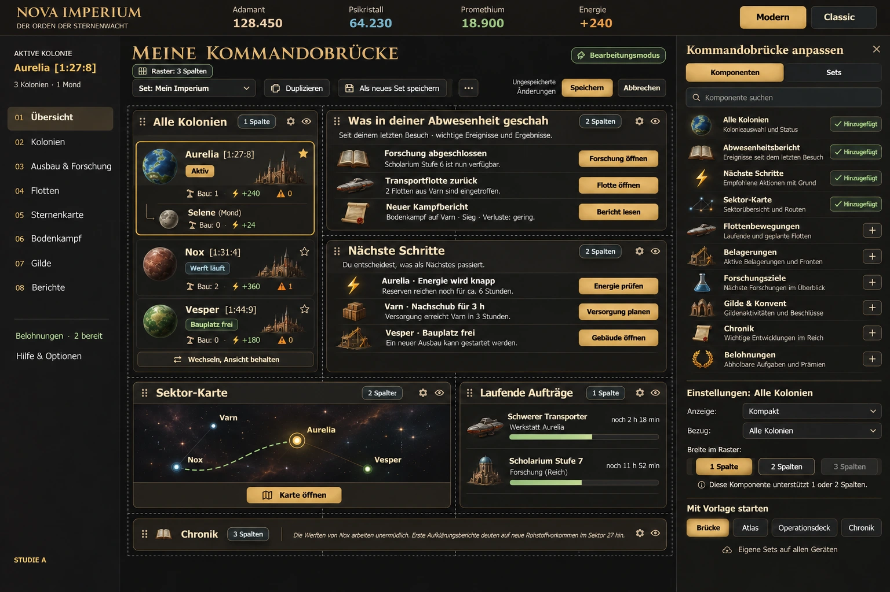

# Configurable command dashboard — owner follow-up, 2026-11-16

## Confirmed direction [E]

The owner wants a mixture of all four interface directions. They all have a purpose. Provide a component dashboard with presets that can be adapted, duplicated, saved as named personal sets and deleted. Especially important: **next steps**, **what happened while away**, direct links to the next action, and **all colonies for fast switching**. New features should be able to bring new dashboard components.

The dashboard uses a grid. A component may occupy **one, two or three columns**, but **the component declares the widths it supports**. Not every component needs every width; offer sizes only where meaningful. These are discrete supported variants, not arbitrary free stretching.

The global Modern/Classic switching requirement and the integration with galaxy map #160 and siege #155 remain unchanged.

**[E] Asset direction:** reuse the existing icons under `src/client/static/icons/` and planet textures under `src/client/static/planets/`. Create a new icon only when an appropriate original asset does not exist, following the established framed bronze/gold illustration style. The owner explicitly likes the Sektor-Karte and editing mode of this study; retain those directions. Production UI must reference original source files directly, not extract icons from a generated mockup.

## Image

Illustrative AI-generated UI concept based on the earlier Nova study. Original generation followed by a grid-specific image edit and an asset-reference correction using the actual Nova icon/planet sheet. Example data and wording are not game rules or a pixel-perfect implementation specification; energy remains Nova's production/consumption balance rather than a stored reserve. The image shows editing mode, one-column colonies, two-column briefing/next steps/map, one-column queues, and a full-width three-column chronicle. There is a single visual grid, not four separate dashboards that must all ship.

## Suggested component catalog [V]

Widths in this table apply to the **three-column desktop grid**. A responsive phone variant is a separate requirement; a component that offers only desktop widths 2/3 must still have an appropriate narrow-screen presentation.

| Component | Offered desktop spans | Variants and direct actions |
|---|---|---|
| Alle Kolonien | 1, 2 | 1: planet/moon list with status and switch. 2: comparative rows with build/research/yard/energy indicators. |
| Was in deiner Abwesenheit geschah | 1, 2, 3 | 1: short relevant digest. 2: digest with reasons and direct actions. 3: expanded timeline/chronicle of the same known events. |
| Nächste Schritte | 1, 2 | 1: compact contextual actions. 2: reasons, consequences/blockers and target-specific buttons. |
| Sektor-Karte | 2, 3 | 2: focused region and selected target. 3: broader map with inspector/layers. Full map is reachable in either. |
| Laufende Aufträge | 1, 2 | 1: compact active queues. 2: queues grouped by colony/type with more context. |
| Flottenbewegungen | 1, 2, 3 | 1: next arrivals. 2: full movement list. 3: route overview beside movement list. |
| Belagerungen | 1, 2 | 1: phase/deadline/supply summary. 2: operation overview with draft status and links to ground orders/supply editor. |
| Forschungsziele | 1, 2 | 1: pinned goal. 2: prerequisites, available steps and costs. |
| Rohstoffe & Energie | 1, 2 | 1: selected colony balance. 2: production, capacity and labeled comparison of selected colonies. Energy remains a production/use balance. |
| Chronik | 1, 2, 3 | 1: short entry. 2: return story. 3: broad timeline or story strip. |
| Gilde & Konvent | 1, 2 | 1: relevant notices. 2: discussions/ballots and direct actions, if enabled and authorized. |
| Belohnungen | 1 | Small claimable-items summary; open the complete rewards page. |
| Eigene Ziele & Verknüpfungen | 1 | Player-pinned goals and target-specific shortcuts; no automated gameplay. |

This is a proposed initial catalog, not final approval of any underlying game feature. Disabled/unimplemented features do not appear as working components.

## Behavior of Alle Kolonien [E + V]

**[E]** A component with all colonies for quick switching.

**[V]** Show all owned planets and nested moons, current selection, coordinates, favorites, a few concise status indicators and relevant build/energy/operation warnings. Support list and compact comparison variants, manual/favorite/name order and search when the empire grows. Default to showing all; filtering must be explicit and recognizable.

Clicking another colony switches the active planet while preserving the current logical page, e.g. buildings on Aurelia → buildings on Nox. Queues and resource values update to that colony. Show a clear reason when the destination cannot support the current view (moon-only/planet-only actions). Selecting an object on the map remains distinct from changing a fleet's origin; drafts remain scoped to their original place and never silently retarget. A short colony switcher remains globally reachable if the dashboard component is removed or the player is on another page.

## Presets and personal sets [E + V]

**[E]** Start with presets and allow adaptation, duplicate, save own named sets and delete.

**[V]** Built-in Brücke, Atlas, Operationsdeck and Chronik are stable starting layouts. Editing a built-in preset creates a personal copy. Personal sets support activate, rename, duplicate, save, save as new set and delete. Deleting a layout never deletes colonies, progress or orders. Deleting the active personal set selects a safe built-in fallback; unsaved changes are handled explicitly.

Use a named player's default set; save account preferences on the server. Treat the set and global Modern/Classic presentation as independent. Each set stores ordered component instances, chosen supported spans, scope (selected colony/all colonies/pinned colony where appropriate) and component settings. Optional multiple instances are permitted only when the component supports a meaningful distinct scope.

## Grid contract [E + V]

**[E]** A component defines supported 1/2/3-column widths and does not have to offer all of them.

**[V]** Each component registration declares stable ID, feature/version, title, supported desktop spans, default span, narrow-screen presentation, settings/scopes, instance limits, feature flag/permission checks, loading/empty/error states and content renderer. Size choices must be generated from that declaration; drag handles snap only to supported spans. A disabled option may explain why a width is unavailable.

Each supported width has a purposeful content layout: a list can become a comparison, a digest can become a timeline. Do not merely scale text or stretch empty space. Height follows content within useful summary bounds; show more/open full page for long collections. Avoid independent scrolling inside every small card.

Three columns on desktop; two on medium screens; one on phones. Reflow to a component's responsive presentation rather than offering an unsupported desktop width. Keep a deterministic mobile order configurable per set; desktop width and mobile order do not overwrite one another. Preserve player reading/action focus during live data updates. Use drag/reorder as an enhancement; also provide move earlier/later, column/width selection and keyboard/touch-accessible controls.

## New features integrate in two complementary ways [E + V]

**[E]** Features may bring their own dashboard components and relevant homepage actions.

**[V]** A feature can register:

1. An optional dedicated component in the catalog, with supported sizes and states.
2. An event/briefing provider for **Abwesenheit** and an action provider for **Nächste Schritte**.

For example a siege can provide a Belagerungen component, a known event that supply arrived, and a contextual next step linking to the correct supply editor or command queue. A convention can provide a component plus a known vote result and an action to an open ballot.

This is declarative game functionality, not arbitrary uploaded plugin code. All visibility follows existing permissions and knowledge rules. Briefings derive from retained, player-visible game events since the player's last confirmed visit/read anchor; recommendations derive from current authorized state and deterministic feature logic, not invented LLM advice. Missing event history is labeled instead of fabricated. Recommendations need stable IDs, reason, target, validity and deduplication.

New components appear in the catalog without silently modifying a player's saved layout. Relevant events/actions may appear within enabled generic briefing/next-step components. Newly installed components can be suggested non-intrusively. Feature-disabled/permission-removed components get a clear unavailable state or a deterministic removal choice; their saved configurations survive where appropriate.

Direct buttons navigate to the exact colony/target and logical next step; they do not spend resources, send troops or submit a ballot automatically. Urgent gameplay signals remain available through the game's global notification contract even if the player omits their dashboard component.

## Additional acceptance criteria [V]

- Add/move/remove/resize components, cancel editing, save/reload/rename/duplicate/delete sets; test default and active-set fallback behavior.
- Only declared sizes are selectable; layout validation handles removed components/versions, unavailable widths and permissions gracefully.
- A 1→2 resize changes the intended presentation while preserving component settings and target scope.
- Personal layout retains component positions when features are installed or new cards become available.
- New feature contributions appear in the briefing/next-step streams with correct deduplication and permission/knowledge checks.
- Colony switch keeps the logical page, updates state, preserves draft origin and provides moon/planet incompatibility feedback.
- Responsive reflow at 360 px and keyboard/touch reorder; no reliance on desktop drag handles.
- Grid editing and set activation cannot send duplicate mutation requests or change the game simulation.

The UI concept is not a functional prototype. Evaluate component variants and grid behavior in a subsequent implementation slice.
