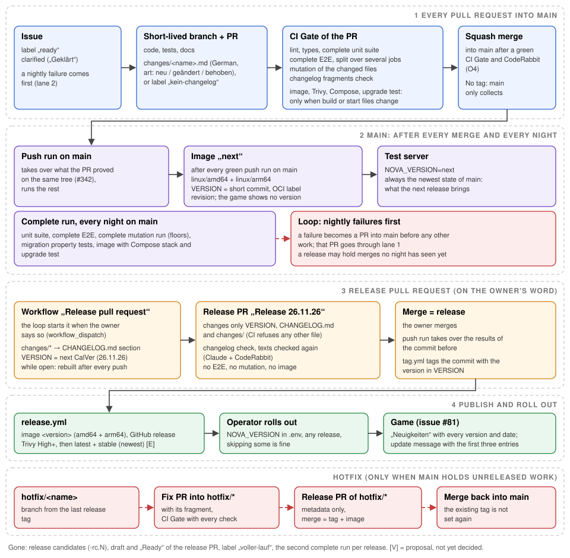

# Decisions

* **[E]** GitHub Flow as in muffelblog: `main` is always deliverable; work
  happens on a branch and reaches `main` through a pull request.
* **[E]** This setup is one pull request with clean commits (round 1); it is
  merged with a squash merge.
* **[E]** Only a pull request with a green "CI Gate" goes to review.
* **[E]** Release: a Git tag in CalVer `YY.M.MICRO` (for example `26.11.0`,
  no `v`). The tag workflow verifies a successful CI push run for the exact
  tagged commit. It then builds the image for linux/amd64 and linux/arm64 and
  pushes it to `ghcr.io/heiss/nova-imperium:<tag>`; its job „latest and
  stable“ points `:latest` and `:stable` at the image of the newest release
  tag (see below), and a GitHub release is created. "Run workflow" by hand is
  a dry run.

## Release pull request (owner, 2026-11-12)

### Metadata only, created on the owner's word (#387, owner, 2026-11-23 and 2026-11-24)

These rules replace the draft, the cheap and the full run, „Ready for
review“, `release-ready.yml` and the label `voller-lauf` of #147; the
bullets they replace below are marked.

* **[E]** The release pull request changes only the metadata files
  `VERSION`, `CHANGELOG.md` and `changes/`; „Detect changes“ of `ci.yml`
  refuses any other file. It runs no expensive job (no unit tests, E2E,
  mutation, image or website) and relies on the results of `main`; the CI
  Gate requires the cheap checks and the changelog check, and refuses an
  expensive job (owner, 2026-11-23).
* **[E]** Its merge is the release: the CalVer tag is set after the green
  push run (`tag.yml`, `scripts/release.sh`). A release needs no green
  complete run of its own state: it may hold merges no nightly run has seen
  yet (owner, 2026-11-23, 65c).
* **[E]** A release pull request is created only when the owner says so:
  the loop starts the workflow „Release pull request“ by hand
  (`workflow_dispatch`). While it is open, a push to `main` rebuilds it; a
  push finds none open and creates none (owner, 2026-11-23). **[V]** `tag.yml`
  starts the workflow on `main` after a hotfix release with the input
  `rebuild=true`: it rebuilds an open release pull request of `main`, so it
  takes a newer version, and creates none.
* **[E]** The push run of a release merge takes over the results of the
  commit before it (owner, 2026-11-24, 77a): `scripts/already-tested.ts`
  gives a push that changes only the metadata files against its first
  parent the proofs of the green push run of that parent, for every job
  that succeeded there or that run skipped with its own proof. The guard
  `src/test/release-metadata.test.ts` lists every file that names a
  metadata file; a new reader fails it until it is listed.
* **[E]** A hotfix release pull request follows the same rules: metadata
  only, no expensive job; the change of a hotfix (as a rule its
  dependencies) comes in its fix pull request with its own CI (owner,
  2026-11-24, 77a). **[V]** A push to a hotfix branch still builds its
  release pull request at once (a hotfix branch exists to be released, and a
  security hotfix releases itself, `security-hotfix.yml`).
* **[V]** No draft, `release-ready.yml` and the label `voller-lauf` are gone
  (taken as recommended, 2026-11-24). The release pull request is created
  as a draft and marked ready by the same run once its version is free and
  no released hotfix waits; it stays a draft while another release branch
  holds its version or a released hotfix is not merged back into `main`
  (the marker in its body), so a draft still cannot be merged then. Before,
  „Release ready“ refused „Ready for review“ in that case (#147).
* **[E]** The strict Trivy scan of a release (owner, 2026-11-24, 79a):
  `release.yml` scans the freshly built release image `<version>` with
  Trivy (High and Critical holes that have a fix, the same severity the
  release pull request used before #387) in its job „Trivy of the release
  image“, each published platform (`linux/amd64`, `linux/arm64`) on its own
  (CodeRabbit on #395), before the job „latest and stable“ moves the aliases. A finding
  stops the aliases (they stay on the previous release), the run fails
  visibly, and the loop tells the owner. The tag and the `<version>` image
  stay as they are. **[V]** The same holds for the check of the release
  image on a CPU without AVX (#456, job „The release image runs on a CPU
  without AVX“, [Docker](/architecture/docker.md)): the job „latest and
  stable“ needs it too. **[V]** Trivy reads the image of each platform from the
  registry (`--image-src remote --platform`), with the credentials of the
  login as a read-only docker config, not from the daemon of the runner:
  the pull of the arm64 image into the amd64 runner left its export to
  Trivy without its content, so the scan of 26.11.28 (arm64) never ran
  (coordinator, 2026-11-25). The scans of `ci.yml` (images built on the
  runner) and `security-hotfix.yml` (the platform of the runner) keep the
  daemon.
* **[E]** No more release candidates: no `<version>-rc.<N>` images,
  `rc-image.yml` is gone (#387 part 2, owner, 2026-11-23; this replaces the
  decision on release candidates of 2026-11-12). The moving image tag `next`
  always holds the newest state of `main`: `next-image.yml` builds it after
  every green CI push run on `main`, for `linux/amd64` and `linux/arm64`.
  Its `VERSION` holds the short commit and the image carries the OCI label
  `org.opencontainers.image.revision`; the game shows no version for it
  (`src/server/news.ts` keeps only a CalVer version). A late run of an
  older push does not move `next` back. `docs/operations.md` names `next`
  for a test server [V].
* **[E]** Decided for #486, not built yet (owner, 2026-11-28): the tag `next`
  goes away; in its place `nightly`, built and published only when the
  three night workflows (`ci.yml` on its schedule, `mutation.yml`,
  `migrations-nightly.yml`) are green for the same commit of `main`, every
  night, also when `main` is unchanged, so the staging server gets Debian's
  security updates (replacing „not built again while `main` is unchanged“
  of the same day); only the moving tag, no dated tags.
  The tags are then `<version>`, `latest` and `stable` from a release and
  `nightly` every night. The owner's staging server pulls `nightly` by
  itself; the repository only describes it in `docs/operations.md`. The
  rest of #486 is proposals [V]. This replaces the bullet above once #486
  is built.
* **[E]** Every night a complete test run on `main` (#387 part 3, owner,
  2026-11-23; its contents accepted 2026-11-24, 77a): `ci.yml` runs on a
  schedule with the unit suite, the E2E suite, the image with the Compose
  stack and the upgrade test, and the website, without the mutation jobs;
  `mutation.yml` runs the complete mutation run (floors) and
  `migrations-nightly.yml` the migration property tests the same night
  [V: the three workflows together, rather than one workflow]. The loop
  looks at them first ([Release loop](/ops/loop.md)).
* **[U]** Verified only after the merge of #387, because a pull request
  cannot run it: that the scheduled run of `ci.yml` starts on `main` and its
  gate accepts it; that `workflow_dispatch` of `release-pr.yml` with the
  release App creates the release pull request; that `next-image.yml`
  pushes `next` to GHCR after a green push run of `main`, for both
  platforms, with the label of the commit; that a push to `main`
  rebuilds an open one and creates none; that its CI is the metadata-only
  run; that the push run of its merge takes over the proofs of the commit
  before (the API answers of `commits/{sha}`, `compare` and the push runs
  of the parent are read only there).

* **[E]** A release is a decision, not every merge: `main` collects merged pull
  requests without a tag; the owner releases by merging the release pull
  request „Release <version>“. Before, every green push to `main` was tagged
  (17 releases in the first twelve days of November 2026).
* **[E]** Short-lived branches stay. What goes into the next release is decided
  at the start of a cycle by classifying the issues (label `ready`; owner,
  2026-11-14, before the milestone „next release“); only their pull requests are merged, because a release is
  always a state of `main` and a merged pull request cannot be left out.
* **[E]** Every pull request that players can notice brings a changelog
  fragment `changes/<name>.md` in German (front matter `art: neu | geändert |
  behoben`, at most 300 characters; `changes/README.md`). Claude writes the
  text and reviews it against the pull request; the release pull request
  checks it again. The CI check „Changelog fragments“
  (`scripts/changelog.ts check`) requires a fragment when a pull request
  changes `src/client`, `src/core`, `src/features`, `src/server/game` or
  `src/server/http` (the admin routes; owner, 2026-11-17), unless it
  carries the label `kein-changelog`, and checks the form of every
  fragment.
* **[E]** New admin settings and admin actions are new features: the
  fragment of their feature names them briefly, saying what the admin can
  now do (owner, 2026-11-17, after the fragments of 26.11.23 lacked „Mond anlegen“, the
  lock of the main planet per round and the default flight time of the
  „Endzeit“); the text check of the release pull request looks for them.
* **[E]** A pull request that extends a feature of the coming release whose
  fragment is still in `changes/` changes that fragment instead of adding
  one; the text check of the release pull request looks for two entries
  about one feature (owner, 2026-11-13, #136: 26.11.22 had two entries on
  the explanation texts).
* **[E]** A wrong text in a published changelog section stays as it is;
  the next release corrects it with a fragment `art: behoben` that starts
  with „Korrektur zu <version>:“ (owner, 2026-11-13, #135, #136).
  `CHANGELOG.md` is never edited by hand.
* **[E]** The workflow „Release pull request“ (`.github/workflows/release-pr.yml`,
  `scripts/release-pr.sh`) runs after every push to `main` and rebuilds the
  branch `release/main` from it: the fragments become a German section of
  `CHANGELOG.md` („## Version 26.11.19 – 12.11.2026“, new before changed
  before fixed), `VERSION` holds the next CalVer version, the fragments are
  removed. The version is the next one not taken by a tag, by `VERSION` or by
  another open release branch (`release/hotfix/*` against `release/main`).
  It opens or updates the pull request with the section, the
  pull requests since the last tag and a checklist; with nothing new since
  the last tag it closes it. It uses the release App's token, because a pull
  request opened with `GITHUB_TOKEN` starts no CI.
* **[E, replaced by #387 on 2026-11-23]** The release pull request runs every check in its full run:
  complete mutation run
  (in 12 parallel shards, merged by a gate job, see
  [Test strategy](/ops/testing.md), #131; the one of a hotfix branch only
  when the hotfix changes what the mutation tests test, see Hotfix),
  Docker image, Trivy, Compose stack, upgrade test with the data of the last
  release, smoke test, and later the SBOM (issue #83). The texts are checked
  by Claude and CodeRabbit (`.coderabbit.yaml`, `changes/**`, `CHANGELOG.md`).
* **[E, replaced by #387 on 2026-11-23]** The release pull request of `main` runs the expensive checks and
  gets its candidate image on request only (owner, 2026-11-13 and
  2026-11-14, #147): every push to `main` rebuilds it and cancelled its
  running CI (four of five runs on 2026-11-13). It stays a draft: every
  rebuild sets it back to draft before its push (`scripts/release-pr.sh`,
  with the release App's token, which has „Pull requests: Read and
  write“), and the workflow no longer marks it ready. A draft cannot be
  merged.
* **[E, replaced by #387 on 2026-11-23]** The cheap run: on the draft, the CI runs only the checks that run
  for every change (secrets and dependencies, migrations, workflow lint,
  CodeQL) and the changelog check; no unit tests, E2E, mutation, image,
  Trivy, Compose stack or upgrade test. „Detect changes“ decides it from
  `pull_request.draft` of the event that started the run, for the head
  `release/main` into `main`. The CI Gate checks these jobs and then fails
  on purpose („the full run starts with Ready for review“), so the draft is
  never green on its head commit without a full run, and `rc-image.yml`
  publishes no candidate from it. The draft shows a red CI Gate; the loop
  and the owner read the single jobs.
* **[E, replaced by #387 on 2026-11-23]** The full run: marking the release pull request „Ready for review“
  starts it. `ci.yml` does not listen to `ready_for_review`, because then
  every pull request would get a run there, and a job skipped by a
  condition counts as a success, even as the required check: a skipped CI
  Gate could replace a red one. Instead the workflow „Release ready“
  (`.github/workflows/release-ready.yml`) adds the label `voller-lauf` with
  the release App's token and removes it again; both events start `ci.yml`
  (`labeled`, `unlabeled`) with `draft: false`, and the second run cancels
  the first (same concurrency group). Events caused by `GITHUB_TOKEN` would
  start no workflow; those of the App do. The workflow runs only for the
  head `release/main` of this repository into `main`; every other pull
  request, hotfix release pull requests included, is unchanged.
* **[E, replaced by #387 on 2026-11-23]** In every other release pull request (head `release/…`) the CI
  Gate requires the code checks, the image and the website; the mutation
  jobs too, except in the release pull request of a hotfix branch, where
  they follow #146.
* **[E, replaced by #387 on 2026-11-23]** „Release ready“ runs on `pull_request_target` (owner,
  2026-11-14): the workflow of
  `main` runs with `GITHUB_REF` main, so the environment `release` hands out
  the App key; a `pull_request` run has `refs/pull/N/merge` and would not
  get it (GitHub changelog of 2025-11-07: environment branch rules are
  checked against the ref the run executes on). It checks out nothing and
  only labels the pull request. It creates the label `voller-lauf` when it
  is missing.
* **[E, replaced by #387 on 2026-11-23]** „Ready for review“ is refused while a released hotfix is not
  merged back into `main` (owner, 2026-11-14, #147): `scripts/release-pr.sh`
  then writes the marker `<!-- release-pr: unmerged-hotfix -->` into the
  body with its note. „Release ready“ reads the current body; with the
  marker it sets the pull request back to draft (`gh pr ready --undo`, App
  token; `converted_to_draft` starts no CI), posts one comment in English
  that says why, touches no label and fails its run. A body it cannot read
  starts no full run either.
* **[E]** No merge freeze while a tested release pull request is open
  (owner, 2026-11-13, #149: „yes, always“; a safe system matters more than
  the release in progress). Every merge into `main`, a security update of
  Renovate or any other, rebuilds the release pull request and sets it
  back to draft (#147), so its last full run no longer counts and it
  cannot be merged on an old result. The release loop keeps running until
  the owner has merged it, marks it ready again after every rebuild,
  waits for the full run and the candidate image and then tells the owner;
  the draft state and that message are the only notice, no comment on the
  pull request and no issue ([Release loop](/ops/loop.md)).
* **[U, replaced by #387 on 2026-11-23]** Checked only on the first release pull request after the merge:
  that the App may create the label and comment with „Pull requests:
  write“ (GitHub's documentation names „Issues“ or „Pull requests“ write
  for labels and issue comments; else create the label by hand), that the `labeled` and `unlabeled` runs carry
  `draft: false` and start in one concurrency group, that the CI Gate of
  the full run replaces the red one of the cheap run, and that
  `rc-image.yml` publishes the candidate of the full run (its actor is the
  release App).
* **[E]** Merging it is the release: after the CI push run, `tag.yml` tags the
  commit with the version in `VERSION` (`scripts/release.sh`). Only a commit
  that changes `VERSION` is tagged; a version that is already a tag is not
  tagged again. The commit of the CI run is tagged even when the branch has
  moved on in the meantime, as long as it is still part of the branch.
  A version that is already the tag of another release (two release pull
  requests picked it at the same moment) fails the tag job loudly; the
  release pull request is a draft from before the push of its branch until
  the check after the push found no other release branch with its version
  (a draft cannot be merged); a failed or cancelled run leaves it a draft,
  and the next run picks a free version and marks a hotfix release pull
  request ready; the one of `main` stays a draft (#147). CodeRabbit
  reviews it when it is opened; later rebuilds are not reviewed again
  (`auto_incremental_review: false`, seen on pull request #88), a review can
  be asked for with `@coderabbitai review`.
  `release.yml` publishes the image as `<version>`; its serialized job
  „latest and stable“ then points both aliases at the image of the newest
  release tag, only in that release's own run after its scan passed (79a;
  that only the own run moves them is [V], 2026-11-24: a run of an older
  release would otherwise move them onto a newer image whose scan failed),
  so a re-run of an older release or a hotfix of an older line never moves
  them back,
  and a GitHub release whose notes are the section of `CHANGELOG.md`,
  followed by GitHub's list of pull requests.
* **[E, replaced by #387 on 2026-11-23]** Release candidates (owner, 2026-11-12): every green CI run of a
  release pull request (of `main`: its full run, #147) publishes `<version>-rc.<N>` and moves `next` to it
  when that run is still the head of the release branch
  (`.github/workflows/rc-image.yml`). N is the number of merges on the base
  branch since the last release. In the candidate, `VERSION` holds
  `<version>-rc.<N>`; the game treats it as a development build and sends
  no update message. `latest` and `stable` point to the newest release
  only, so no operator gets a candidate by accident; a staging instance
  runs `next`. Candidate numbers are not Git tags (the release flow finds
  the last release tag by pattern).
* **[E]** Ordinary pull requests run the Docker image, Trivy, the Compose stack
  and the upgrade test only when a file of the image build, its start or the
  upgrade changes: `Dockerfile`, `docker/`, `compose*.yaml`, dependencies,
  `.node-version`, the database code, the server start and the CI workflow.
  Game code alone does not build the image in its pull request; every push
  to `main` and the full run of the release pull request do.
* **[E]** The operator decides which release to roll out (`NOVA_VERSION`);
  skipping releases is fine. The game shows every version since the one that
  ran before ([Changelog in the game](/features/changelog.md)).

## Collecting pull request (owner, 2026-11-22)

A collecting pull request bundles the issues of a release in one branch
and one CI run (26.11.24; #347 for 26.11.25).

* **[E]** Its branch asks CodeRabbit for the review at its first push, with
  `@coderabbitai review` on the draft, not only when it is marked ready, so
  the findings arrive before the long run (owner, 2026-11-22). Reason: the
  six findings on the second part of #347 came after its complete run had
  started, and their fix started it again. CodeRabbit reviews no draft by
  itself (see „Proposals“ below).
* **[E]** The scope of a release closes; what comes later goes to the next
  release, unless the owner says „Ausnahme“ for it, and the loop names the
  consequence for the date each time (owner, 2026-11-22). **[V]** The scope
  closes when the collecting pull request is opened (the owner decided the
  rule, not the moment). Reason: the scope of 26.11.25 grew from four items
  to twelve. **[U]** How the loop knows whether an issue was in the scope
  when it closed, and how an „Ausnahme“ is recorded, is open (O24 in
  [Open points](/open-points.md)); until it is decided the rule is text and
  the coordinating session watches it (owner, 2026-11-23).
* **[E]** 26.11.25 was released from its collecting pull request, without a
  release pull request and a candidate image, by the owner's exception of
  2026-11-22 ([log](/log/2026-11-22-release-in-collect.md)); the rule for
  such a release is planned in #363.

## Hotfix (owner, 2026-11-12)

* **[E]** When `main` holds no unreleased work, a hotfix is a normal release
  pull request. Otherwise: the owner creates `hotfix/<name>` from the last
  release tag (`git push origin '<tag>^{commit}:refs/heads/hotfix/<name>'`; release
  tags are annotated, a branch must point at the commit), the fix
  goes into it through a pull request with its fragment, and the workflow
  builds a release pull request into `hotfix/<name>` the same way; its merge
  tags the next version. Then `hotfix/<name>` is merged back into `main`,
  after its tag exists; its version is not tagged again, and the release
  pull request of `main` is rebuilt on top of it.
* **[E]** CI and the tag workflow run for pushes to `main` and `hotfix/**`; the
  migration check compares the first push of a hotfix branch with the release
  tag it starts from.
* **[E]** The pull requests into a hotfix branch run the mutation jobs only
  when the hotfix changes what they test (owner, 2026-11-13, #146), so a
  hotfix with code in `src/` runs them, and one with only dependency or
  `Dockerfile` changes (as a rule a security hotfix) does not; every other
  check still runs. A push to `hotfix/**` runs the mutation jobs unless a
  proof of #342 covers them (CodeRabbit on #395): the mutation jobs of the
  pull request it merged succeeded on the identical tree, complete or of the
  changed files (#309); that run's „Detect changes“ found nothing to mutate;
  or the push changes only the metadata files and takes over the green push
  run of its parent (77a). The one list of the proofs is
  [Proofs of a push run](/ops/testing/push-proofs.md).
  See [Test strategy](/ops/testing.md). **[E, replaced by #387 on
  2026-11-23]** What this rule said of the release pull requests: the one of
  a hotfix branch compared with its release tag and kept its automatic full
  run, and the one of `main` ran its complete mutation run in its full run
  (#147). Since #387 a release pull request, of `main` or of a hotfix
  branch, changes only the metadata files and runs no mutation job.

* **[E]** Renovate opens pull requests for dependencies and images, waits
  3 days after a release (`minimumReleaseAge`) and merges patch updates
  automatically once the CI is green.
  Its security pull requests (from GitHub's Dependabot alerts) wait for
  nothing: `vulnerabilityAlerts` sets `minimumReleaseAge` to null for every
  severity by default, checked in Renovate's documentation (owner,
  2026-11-12: „so lassen, alle sofort“). Renovate has no matcher for the
  severity; Dependabot's own security updates are off, so no hole gets two
  pull requests.
* **[E]** Renovate merges its ordinary patch updates only at night, from
  02:00 to 04:59 UTC (`automergeSchedule`), and does so itself instead of
  through GitHub's auto-merge (`platformAutomerge: false`), which knows no
  time window. Security updates still merge at any time. Reason: every
  merge into main puts all open pull requests behind main, and each then
  needs a new run of the CI; on 2026-11-18 and 2026-11-19 two patch
  updates (#311, #315) cost four pull requests an hour each (owner,
  2026-11-19).
* **[E]** Renovate's ordinary minor updates do not merge themselves; the
  release loop merges them between features and before it makes the
  release pull request ready (owner, 2026-11-16 and 2026-11-18): patch and
  minor updates of a version from 1.0 on, one at a time under O4 on a head
  up to date with `main`. **[V]** A red one stays open and
  is named to the owner with the release; major updates and minor updates
  below 1.0 wait for the owner, each with its own issue that the loop
  finds or opens without a status label. Renovate keeps
  single pull requests at any time, without group or schedule (owner,
  2026-11-16). See [Release loop](/ops/loop.md).
* **[E]** Renovate rebases a pull request only when it conflicts with
  `main` (`rebaseWhen: conflicted`); only the updates that merge
  themselves follow `main` (`behind-base-branch`: ordinary patch updates
  and the security updates above) (owner, 2026-11-18). Reason: with the
  default `auto` and a ruleset that wants an up-to-date head, Renovate
  rebased every open pull request after every push to `main`: 50 of the
  100 CI runs from 2026-11-17 10:15 to 2026-11-18 03:45 UTC ran on
  `renovate/…` branches (about 770 of 2,035 minutes of run time), 6 to 7
  of them within two minutes after each of the 7 pushes to `main`, and
  they kept the runners from the pull requests being built. Who merges a
  Renovate pull request asks for its rebase first: tick the box
  „rebase/retry“ at the end of its description (an edit of the
  description starts no CI run; the label `rebase` works too, but starts
  one), then wait for the CI of the new head. Checked in the code of
  Renovate 44.251.0 (`workers/repository/update/branch/reuse.js`,
  `check-existing.js`) and seen on GitHub on 2026-11-18: for four and a
  half minutes after the merge of #294 Renovate left its three open
  branches alone (before, it rebased all of them within two minutes); a
  tick of the box of #142 at 09:10 UTC rebased it by 09:12, a tick of the
  box of #153 at 09:30 rebased it by 09:32, and no other branch moved.
  The description of a pull request now reads „Rebasing: Whenever PR
  becomes conflicted, or you tick the rebase/retry checkbox“.
* **[E]** A major update and a minor update below 1.0 get no pull request
  until the owner approves it (`dependencyDashboardApproval`; owner,
  2026-11-18): Renovate lists it under „Pending Approval“ in the issue
  „Dependency Dashboard“ (#5), and a tick there opens the pull request.
  Reason: such a pull request waits for the owner anyway, and a blocked
  one (TypeScript 7, #15: 6 of 7 runs red) ran the CI for nothing. The
  approval gates only the creation of a branch
  (`workers/repository/update/branch/index.js`), so a pull request that is
  open already stays. Security pull requests need no approval
  (`vulnerabilityAlerts` sets it to false, by default and in
  `renovate.json`). **[V]** The loop reads the list in #5 where it read
  the open pull requests before, and the issue of such an update names
  the entry of #5; the box is ticked when the issue is built.
* **[E]** Both rules were tried before the merge with Renovate 44.251.0
  on the local platform (`--platform=local --dry-run=lookup`,
  `LOG_LEVEL=trace`, the branch configurations of the log): the major
  update TypeScript 6 to 7 got `dependencyDashboardApproval: true`; the
  nine minor updates got `rebaseWhen: conflicted`, no approval and no
  automerge; the patch update got `rebaseWhen: behind-base-branch` and
  `automerge: true`. Not seen: a minor update below 1.0 (none was due)
  and a security pull request (the run has no alerts).
* **[E]** Security pull requests merge themselves up to minor updates
  (owner, 2026-11-13, #148): `vulnerabilityAlerts.packageRules` in
  `renovate.json` sets `automerge` for patch updates, for minor updates
  of a current version from 1.0 on, and for pin and digest updates
  (`pin`, `pinDigest`, `digest`), once the CI Gate is green. A major
  update waits for the owner. Versions below 1.0 (`0.x`) count like major
  updates: only a patch merges itself, a minor update waits for the owner.
  Development dependencies follow the same rule.
* **[E]** A red security pull request is handled by the release loop like
  its own (owner, 2026-11-13, #148): it finds the root cause and fixes it
  in its own `claude/…` pull request, never by a push to the Renovate
  branch; if it cannot, it asks the owner. That fix pull request does not
  count toward the limit of four open own pull requests (security first;
  [Release loop](/ops/loop.md)).
* **[E]** Renovate applies the content of `vulnerabilityAlerts` as `force`
  on the package rule of every alert, over every other rule
  (`lib/workers/repository/init/vulnerability.ts`, `lib/config/utils.ts`);
  its nested `packageRules` are evaluated per update type. Proven before
  the merge of #148 with Renovate 44.239.1 on the local platform
  (`--platform=local --dry-run=lookup`, `LOG_LEVEL=trace`; the alert
  source stubbed with synthetic Dependabot alerts, the rest of Renovate
  unchanged): patch, minor and development-dependency patch and minor
  updates got `automerge: true`; the major, the development major and the
  `0.x` minor update got `automerge: false`; an ordinary minor update kept
  `automerge: false`. With the previous `renovate.json` the minor security
  updates got `automerge: false`. The stub covers npm only: GitHub Actions
  alerts were not tried, because the run could not reach GitHub's API.
  The pin and digest rule passes `renovate-config-validator --strict`, but
  its behaviour was not observed: npm alerts give version updates (the
  alert forces `rangeStrategy: update-lockfile`, a range dependency got a
  minor update, not a pin), and the digest cases (GitHub Actions) need
  GitHub's API. The first such security pull request on GitHub shows it.

* **[E]** A push to `main` or `hotfix/**` does not repeat what already ran
  green on identical content, and the tag accepts that proof (owner,
  2026-11-21, #342; it replaces the rule „every push to `main` runs the full
  suite“ of 2026-11-11). The CI looks up the pull request the pushed commit
  merged and compares the Git tree of the pushed commit with the tree of the
  head commit that pull request was tested on. With an identical tree each
  expensive job (lint, types, unit tests and build; E2E; the complete
  mutation run; the Docker image with the Compose stack; the documentation
  website) is skipped exactly when the same job succeeded in a green CI run
  of that head (event `pull_request`, this repository, workflow „CI“); a job
  that did not run there runs on the push (the mutation jobs are proven by
  the pull request's complete run or by its run of the changed files, #309,
  see below). A push that changes only the metadata files takes over the
  green push run of its parent instead (77a). Every other case runs
  everything: no pull request, two of them, a different tree, a direct
  push, a red or missing run, an error of the lookup (the rule fails
  closed). The one list of the proofs is
  [Proofs of a push run](/ops/testing/push-proofs.md). The CI Gate
  of a push requires for every job its own success or the named proof and
  prints it. `tag.yml` is unchanged: it still needs a green CI push run of
  the tagged commit, which after a release merge now takes minutes. The
  build: [Proofs of a push run](/ops/testing/push-proofs.md). A push after a
  pull request with a partial mutation run does not run the complete shards:
  the pull request's own mutation jobs, complete or partial, prove them, and
  so does a run that found nothing to mutate ([V], coordinator, 2026-11-21;
  not a result taken over from another tree, #167); the nightly run is
  enough for the complete run (the release pull request no longer runs
  one, #387), and the shards run on a push only when its tree is not
  proven (owner, 2026-11-21, O23).
* **[E]** The nightly run in `.github/workflows/mutation.yml` tests every
  mutant, in parallel shards with a gate job on the merged report (owner,
  2026-11-12, #131). **[E, replaced by #387 on 2026-11-23]** The release
  pull request tested every mutant too; since #387 it runs no mutation
  job.

## Security hotfix (owner, 2026-11-12)

* **[E]** A hole rated High or Critical in the published release goes to
  `stable` at once, as a hotfix of the last release tag without the
  unreleased work of `main`: „lieber ein kaputtes Deployment für eine
  kritische Sicherheitslücke als ein gehacktes System“.
* **[E]** Source: the image of the newest release tag (what `stable` names),
  scanned by Trivy every hour and after every release
  (`.github/workflows/security-hotfix.yml`). Dependabot alerts only look at
  `main`; a hole fixed there is still in `stable`. Only holes with a fix
  count. npm packages are rated by the higher of GitHub's rating (GHSA,
  `VendorSeverity.ghsa`) and Trivy's own. Everything else (the
  base image) is rated by Trivy.
* **[E]** The fix is applied again on the release tag, not cherry-picked
  (`scripts/security-hotfix.ts`): every older copy of a package gets a pnpm
  override `<name>@<<fixed>`, a dependency of `package.json` also gets the
  fixed version; the job then checks that `pnpm-lock.yaml` holds no version
  below a fix. The overrides of the fix are the first of the map, because
  among overrides that match the same dependency pnpm applies the first
  one; an override of the same selector and an older pin of the same
  package (`<name>@<<lower>`) are removed (#284, tested with pnpm
  12.21.0). An override bound to a parent (`parent>name`) still wins: the
  check then fails and names the overrides of the package. The check
  reads only the installed packages of the lockfile. The override goes where the pnpm of the release tag reads
  it (`packageManager`): into `overrides` of `pnpm-workspace.yaml` from
  pnpm 11 on, into the field `pnpm` of `package.json` for an older release
  (#264). A hole in the base image pins the newest digest of
  `node:26-slim`. The fragment says „Sicherheitsupdate“ without package
  names.
* **[E]** The release App creates `hotfix/sec-<id>` (bypass in the ruleset
  „hotfix-anlegen“, creation only) and the pull request `sec-fix/<id>` into
  it; that pull request and the release pull request of `hotfix/sec-*`
  merge themselves when the CI Gate is green (`gh pr merge --auto`). The
  owner merges `hotfix/sec-*` back into `main`. **[E]** The pull request of
  that merge-back does not come from the hotfix branch (owner, 2026-11-25,
  111a): the ruleset of `hotfix/**` lets only a pull request change it, and
  the ruleset of `main` wants an up-to-date branch and a linear history, so
  such a pull request could neither be updated nor merged once `main` moved
  (#402, replaced by #403). **[V]** `tag.yml` builds `hotfix-back/<name>`,
  the current `main` with the hotfix merged in, and opens the pull request
  from it (`scripts/hotfix-back.sh open`); `release-pr.yml` builds every
  open one again from the new `main` after each push to `main`
  (`hotfix-back.sh rebuild`). The hotfix branch itself is never changed. A
  conflict stops the job with the files named, and the branch and its pull
  request stay as they were. After the squash, `release-pr.sh` counts the
  hotfix as merged back (`VERSION` held its tag). Tests:
  `src/test/hotfix-back.test.ts`. **[E]** The automatic merge-back stays
  for security hotfixes (`hotfix/sec-*`) only (owner, 2026-11-25, 118a).
  **[E]** The squashed merge-back is no release (owner, 2026-11-25, 116a):
  its push changes `VERSION` of `main` to the hotfix's tag, and `release.sh`
  says „<tag> is the release of a merged-back hotfix: nothing to tag.“ and
  ends green. **[V]** It counts as a merge-back when the tag's commit is on
  a hotfix branch (fetched for the check) and the pushed commit is exactly
  its parent with the hotfix merged in (`git merge-tree`), as the squash of
  `hotfix-back/<name>` is; a tag on a commit that is neither an ancestor
  nor such a merge-back still fails as before, so a release commit of
  `main` that took a hotfix's version (O25) stays refused, and the rule
  against a release after a newer one (108) is unchanged for new tags.
  `release-pr.sh` rebuilds the release pull request of `main` on that push.
  Tests: `src/test/release-tag.test.ts`, `src/test/release-pr.test.ts`. While a released hotfix is not merged back, the release pull
  request of `main` stays a draft (`scripts/release-pr.sh`; its body says
  so with its marker, #147; since #387 the same run creates it as a draft
  and marks it ready only when no released hotfix waits and no other
  release branch holds its version, and sets it back to draft when a
  rebuild fails after its push): its release would drop the fix from
  `stable`. **[V]** (coordinator, 2026-11-24; CodeRabbit on #395: the
  draft is best effort) The CI of a release head refuses the same on every
  push to it: „Detect changes“ runs `sh scripts/release-pr.sh check`, the
  checks of `release-pr.sh` itself (no copy), and fails while a released
  hotfix is not merged back (base `main`), while another release branch
  holds its version or while its version is a tag already; the CI Gate
  requires „Detect changes“. Once the hotfix is merged back and the release
  head rebuilt, it passes again (`src/test/release-guards.test.ts`).
  **[E]** Never a release after a newer one (owner, 2026-11-25, 108): gaps
  in the numbers are allowed (26.11.26, kept by an old release pull request
  when a security hotfix took 26.11.27, is skipped and the next release is
  26.11.28), but a version at or below the newest CalVer tag is never
  released, a hotfix release included. **[V]** Checked twice, each part of
  YY.M.MICRO as a number (26.11.9 before 26.11.10, 26.9 before 26.10, 26.12
  before 27.1): the CI of a release head (`release-pr.sh check`) refuses it
  and names the newest tag and the way out (the release pull request is
  rebuilt from its base and takes the next free version, or a new one on
  the owner's word), and `release.sh` tags no such version, so a merge
  that slipped past the gate is neither tagged nor published and no alias
  moves. The two scripts carry the same small comparison (each is tested
  alone); tests in `src/test/release-guards.test.ts` and
  `src/test/release-tag.test.ts`.
  **[E]** A hotfix takes the next version after the tags (owner,
  2026-11-25, 108a): it ignores the version the open release pull request
  of `main` holds, and that pull request moves one up on its rebuild, which
  `tag.yml` starts after every hotfix release. **[V]** `next-version` of
  `scripts/changelog.ts` (`heldBy`) leaves out `release/main` for a
  `release/hotfix/*` branch and still counts every hotfix release branch
  for `release/main`; `taken_by` of `release-pr.sh` does the same, so when
  a hotfix and `main` pick the same version, `main` yields (its release
  pull request and its CI fail until it is rebuilt), never the hotfix. Two
  hotfixes still keep apart. A failed rebuild may leave a gap; the rule
  above guards that no release comes after a newer one.
  **[E]** A double failure is accepted (owner, 2026-11-25, 82a): when a
  rebuild fails after its push and setting the pull request back to draft
  fails as well, the pull request keeps the new head with the title and
  the body of the run before. Its text is stale until the next rebuild
  writes it again; what is released is still guarded by the CI of the
  release head above. After every hotfix release, `tag.yml`
  rebuilds the release pull request of `main`, so its version is newer than
  the hotfix and its release becomes `stable` again.
* **[E]** The id is a hash of the fixed packages and the base image holes, so
  the same plan never starts a second hotfix; a scan with a different set
  of holes has another id and starts a new one. One hotfix at a time: a new
  one waits while another `hotfix/sec-*` is on its way (its fix commit or
  an open fix pull request exists and no release tag holds it), because a
  second hotfix from the same tag would release without the first fix.
* **[E]** When a released hotfix comes back with the same id (the scan of the
  newest release still finds the same plan), an issue says so and nothing
  is retried. A branch the job created without a fix pull request is
  finished by the next scan while it still starts at the newest release and
  no other hotfix is on its way. When it no longer starts at the newest
  release, an issue asks the owner to delete it.
* **[E]** The job does not scan the new image before it starts. A hole in
  the base image always changes the `Dockerfile` (`ARG OS_UPDATES=sec-<id>`,
  and the newest digest when there is one), so its hotfix rebuilds the image
  with Debian's current security updates. If a High or Critical hole with
  a fix is still in the new image, the Trivy gate of the CI blocks the fix
  pull request (see below), so the hotfix does not release; the open fix
  pull request keeps later scans waiting, and the owner decides; nothing is
  retried automatically. The CI and the hourly scan see only the `amd64`
  image, so a hole left only in the `arm64` image is not caught there; the
  scan of the release image in `release.yml` checks both platforms before
  the aliases move (79a; CodeRabbit on #395). The job fails only when `package.json`,
  `pnpm-lock.yaml` and `Dockerfile` stay as in the release.
* **[E]** A release older than the release pull request (26.11.18 and
  older, no `scripts/release-pr.sh`) gets no automatic hotfix: its hotfix
  branch could not release, so neither a new nor a resumed hotfix starts.
  The issue says to release `main` instead (an issue opened earlier gets
  this as a comment, once); the
  first scan on 2026-11-12 found two High holes in `zlib1g` of the base
  image of 26.11.18 (issue #97).
* **[E]** What goes out as a release is checked before it goes out (owner,
  2026-11-12, CodeRabbit security finding on pull request #105): in a pull
  request into `hotfix/**` and a push to `hotfix/**`, Trivy in the CI blocks
  every High and Critical hole with a fix. **[E, replaced by #387 and 79a
  on 2026-11-24]** The release pull request did the same; it builds no image
  since #387. Instead `release.yml` scans the freshly built release image,
  each platform, for every High and Critical hole with a fix before the
  aliases move (79a, above); a finding fails the run and leaves `latest` and
  `stable` on the previous release. Other pull requests block only on the Critical holes they bring in:
  the CI also builds and scans the image of the base branch and leaves out
  what is there already (`scripts/trivy-gate.ts`), so two Renovate pull
  requests that each fix one of two holes do not block each other (owner,
  2026-11-12). Pushes to `main` block on every Critical hole. Pull requests
  into `hotfix/**` always build the image.
* **[E]** The hourly scan rates an npm hole by the higher of GitHub's rating
  (GHSA) and Trivy's own, so every hole the CI gate (Trivy's rating) blocks
  in a hotfix is in the hotfix plan (owner, 2026-11-12).
* **[E]** Debian's security updates go into the image that runs (owner,
  2026-11-12): `apt-get full-upgrade` after `FROM … AS app`, which fails when an
  update stays held back,, so a Debian fix
  reaches the image before the official Node image is rebuilt (2× High in
  `zlib1g` of 26.11.19 had a Debian fix but no new `node:26-slim`). Every
  release build passes `OS_UPDATES` (run id and attempt), so the layer cache never
  keeps old packages; a hotfix of the base image sets the default
  `ARG OS_UPDATES=sec-<id>` (and adds the block to a release from before it),
  so the hotfix always changes the `Dockerfile` and fetches the updates again.
  Builds are no longer bit-identical for the same commit.
* **[E]** The base image is pinned to its digest in the `Dockerfile`;
  Renovate opens a pull request for a new digest.

# Tasks of the owner (one-time)

* Make "CI Gate" a required check of `main` (Settings → Branches), so
  Renovate's auto-merge waits for it.
* Release App: grant „Pull requests: Read and write“ in addition to
  „Contents“, so it can open the release pull request (open point O10).
* Create the label `kein-changelog`. Branches `release/*` must allow force
  pushes by the release App (they are rebuilt).
* Protect `hotfix/**` like `main`: changes only through a pull request with
  a green CI Gate (owner decision, 2026-11-12). `tag.yml` runs
  `scripts/release.sh` of a hotfix branch with the release App's token; the
  rule keeps unreviewed scripts out of it (CodeRabbit security finding on
  pull request #84). Rulesets „hotfix“ (deletion, pull request with 0
  approvals, CI Gate up to date, no force push; no bypass) and
  „hotfix-anlegen“ (restrict creations; bypass: repository admin), set up
  2026-11-12.
* Environment `release` (Settings → Environments): deployment branches
  `main` and `hotfix/**`, no required reviewers (owner, 2026-11-12). Move
  `RELEASE_APP_PRIVATE_KEY` from the repository secrets into it and delete
  the repository secret; `release-pr.yml`, `release-ready.yml` and
  `tag.yml` use the environment, so a workflow on any other branch cannot
  read the key (`release-ready.yml` runs the workflow of `main`, #147). `tag.yml` first
  checks without the key whether the commit changes `VERSION`; only a
  release uses the environment, so only releases appear as deployments
  (owner, 2026-11-12). `release-pr.yml` uses it after every push to `main`,
  because it rebuilds the release pull request each time.
* Install the Renovate app for the repository.
* (Gone with #387, 2026-11-23: `release-ready.yml` is removed; the label can be deleted.) Label `voller-lauf` (#147): `release-ready.yml` creates it on first use;
  if the App may not, create it by hand. It is added and removed at once
  and is never left on a pull request.
* Security hotfix (2026-11-12): Dependabot alerts on (done), Dependabot
  security updates off, „Allow auto-merge“ on (Settings → General), and the
  release App as bypass in the ruleset „hotfix-anlegen“.
* After the first release: set the GHCR package to public, or log in with a
  token that has `read:packages` on the server.

# Proposals

* **[E]** The assistant merges its own pull requests with a squash merge
  once the CI Gate is green and no review finding is open (owner decision O4,
  2026-11-10). It takes `main` into a branch only when that pull request is
  the next one to merge, has a conflict or needs code from `main` (owner,
  2026-11-15, [Release loop](/ops/loop.md)).
* **[E]** A design study (mockups under `docs/design/`) is never merged into
  `main`: it stays on its branch and in its open pull request, and its
  issue links the pictures by branch or commit (owner, 2026-11-16, after
  #244 merged the study of #243 by mistake; that one stays on `main`).
  The issue of a study carries `idea` and no status label, so it never
  blocks a release; a study pull request does not count toward the limit
  of open own pull requests (owner, 2026-11-16, CodeRabbit on #245).
* **[E]** CodeRabbit reviews every pull request when it is opened or marked
  ready, not drafts and not later pushes (`.coderabbit.yaml`, owner
  2026-11-11). It comments and does not request changes. Under O4 a finding
  „blocks“ when it concerns security or is marked „Critical“: it is fixed
  before the merge. Every other finding gets an answer in its thread (fixed,
  or why not) before the merge.
