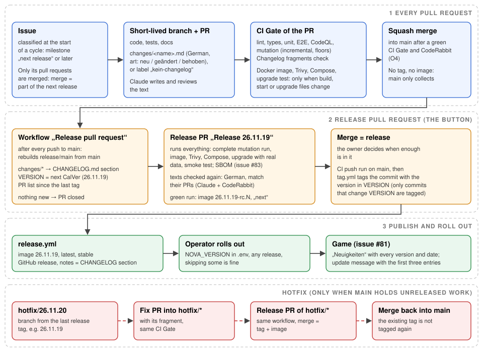

# Decisions

* **[E]** GitHub Flow as in muffelblog: `main` is always deliverable; work
  happens on a branch and reaches `main` through a pull request.
* **[E]** This setup is one pull request with clean commits (round 1); it is
  merged with a squash merge.
* **[E]** Only a pull request with a green "CI Gate" goes to review.
* **[E]** Release: a Git tag in CalVer `YY.M.MICRO` (for example `26.11.0`,
  no `v`). The tag workflow verifies a successful CI push run for the exact
  tagged commit. It then builds the image for linux/amd64 and linux/arm64 and
  pushes it to `ghcr.io/heiss/nova-imperium:<tag>` and `:latest`, and a GitHub
  release is created. "Run workflow" by hand is a dry run.

## Release pull request (owner, 2026-11-12)

* **[E]** A release is a decision, not every merge: `main` collects merged pull
  requests without a tag; the owner releases by merging the release pull
  request „Release <version>“. Before, every green push to `main` was tagged
  (17 releases in the first twelve days of November 2026).
* **[E]** Short-lived branches stay. What goes into the next release is decided
  at the start of a cycle by classifying the issues (milestone „next
  release“); only their pull requests are merged, because a release is
  always a state of `main` and a merged pull request cannot be left out.
* **[E]** Every pull request that players can notice brings a changelog
  fragment `changes/<name>.md` in German (front matter `art: neu | geändert |
  behoben`, at most 300 characters; `changes/README.md`). Claude writes the
  text and reviews it against the pull request; the release pull request
  checks it again. The CI check „Changelog fragments“
  (`scripts/changelog.ts check`) requires a fragment when a pull request
  changes `src/client`, `src/shared` or `src/server/game`, unless it carries
  the label `kein-changelog`, and checks the form of every fragment.
* **[E]** The workflow „Release pull request“ (`.github/workflows/release-pr.yml`,
  `scripts/release-pr.sh`) runs after every push to `main` and rebuilds the
  branch `release/main` from it: the fragments become a German section of
  `CHANGELOG.md` („## Version 26.11.19 – 12.11.2026“, new before changed
  before fixed), `VERSION` holds the next CalVer version, the fragments are
  removed. The version is the next one not taken by a tag, by `VERSION` or by
  another open release branch (`release/hotfix/*` against `release/main`).
  It opens or updates the pull request with the section, the
  pull requests since the last tag and a checklist; with nothing new since
  the last tag it closes it. It uses the release App's token, because a pull
  request opened with `GITHUB_TOKEN` starts no CI.
* **[E]** The release pull request runs every check: complete mutation run,
  Docker image, Trivy, Compose stack, upgrade test with the data of the last
  release, smoke test, and later the SBOM (issue #83). The texts are checked
  by Claude and CodeRabbit (`.coderabbit.yaml`, `changes/**`, `CHANGELOG.md`).
* **[E]** Merging it is the release: after the CI push run, `tag.yml` tags the
  commit with the version in `VERSION` (`scripts/release.sh`). Only a commit
  that changes `VERSION` is tagged; a version that is already a tag is not
  tagged again. The commit of the CI run is tagged even when the branch has
  moved on in the meantime, as long as it is still part of the branch.
  A version that is already the tag of another release (two release pull
  requests picked it at the same moment) fails the tag job loudly; the
  release pull request is a draft from before the push of its branch until
  the check after the push found no other release branch with its version
  (a draft cannot be merged); a failed or cancelled run leaves it a draft,
  and the next run picks a free version and marks it ready. CodeRabbit
  reviews it when it is opened; later rebuilds are not reviewed again
  (`auto_incremental_review: false`, seen on pull request #88), a review can
  be asked for with `@coderabbitai review`.
  `release.yml` publishes the image as `<version>`; its serialized job
  „latest and stable“ then points both aliases at the image of the newest
  release tag, whichever run gets there (a re-run of an older release or a
  hotfix of an older line never moves them back),
  and a GitHub release whose notes are the section of `CHANGELOG.md`,
  followed by GitHub's list of pull requests.
* **[E]** Release candidates (owner, 2026-11-12): every green CI run of a
  release pull request publishes `<version>-rc.<N>` and moves `next` to it
  when that run is still the head of the release branch
  (`.github/workflows/rc-image.yml`). N is the number of merges on the base
  branch since the last release. In the candidate, `VERSION` holds
  `<version>-rc.<N>`; the game treats it as a development build and sends
  no update message. `latest` and `stable` point to the newest release
  only, so no operator gets a candidate by accident; a staging instance
  runs `next`. Candidate numbers are not Git tags (the release flow finds
  the last release tag by pattern).
* **[E]** Ordinary pull requests run the Docker image, Trivy, the Compose stack
  and the upgrade test only when a file of the image build, its start or the
  upgrade changes: `Dockerfile`, `docker/`, `compose*.yaml`, dependencies,
  `.node-version`, the database code, the server start and the CI workflow.
  Game code alone does not build the image in its pull request; every push
  to `main` and the release pull request do.
* **[E]** The operator decides which release to roll out (`NOVA_VERSION`);
  skipping releases is fine. The game shows every version since the one that
  ran before ([Changelog in the game](/features/changelog.md)).

## Hotfix (owner, 2026-11-12)

* **[E]** When `main` holds no unreleased work, a hotfix is a normal release
  pull request. Otherwise: the owner creates `hotfix/<name>` from the last
  release tag (`git push origin '<tag>^{commit}:refs/heads/hotfix/<name>'`; release
  tags are annotated, a branch must point at the commit), the fix
  goes into it through a pull request with its fragment, and the workflow
  builds a release pull request into `hotfix/<name>` the same way; its merge
  tags the next version. Then `hotfix/<name>` is merged back into `main`,
  after its tag exists; its version is not tagged again, and the release
  pull request of `main` is rebuilt on top of it.
* **[E]** CI and the tag workflow run for pushes to `main` and `hotfix/**`; the
  migration check compares the first push of a hotfix branch with the release
  tag it starts from.

* **[E]** Renovate opens pull requests for dependencies and images, waits
  3 days after a release (`minimumReleaseAge`) and merges patch updates
  automatically once the CI is green.
  Its security pull requests (from GitHub's Dependabot alerts) wait for
  nothing: `vulnerabilityAlerts` sets `minimumReleaseAge` to null for every
  severity by default, checked in Renovate's documentation (owner,
  2026-11-12: „so lassen, alle sofort“). Renovate has no matcher for the
  severity; Dependabot's own security updates are off, so no hole gets two
  pull requests.

* **[E]** Every push to `main` runs the full suite with an incremental mutation
  run (owner, 2026-11-11); the release pull request and the nightly run in
  `.github/workflows/mutation.yml` test every mutant.

## Security hotfix (owner, 2026-11-12)

* **[E]** A hole rated High or Critical in the published release goes to
  `stable` at once, as a hotfix of the last release tag without the
  unreleased work of `main`: „lieber ein kaputtes Deployment für eine
  kritische Sicherheitslücke als ein gehacktes System“.
* **[E]** Source: the image of the newest release tag (what `stable` names),
  scanned by Trivy every hour and after every release
  (`.github/workflows/security-hotfix.yml`). Dependabot alerts only look at
  `main`; a hole fixed there is still in `stable`. Only holes with a fix
  count. npm packages are rated by the higher of GitHub's rating (GHSA,
  `VendorSeverity.ghsa`) and Trivy's own. Everything else (the
  base image) is rated by Trivy.
* **[E]** The fix is applied again on the release tag, not cherry-picked
  (`scripts/security-hotfix.ts`): every older copy of a package gets a pnpm
  override `<name>@<<fixed>`, a dependency of `package.json` also gets the
  fixed version; the job then checks that `pnpm-lock.yaml` holds no version
  below a fix. A hole in the base image pins the newest digest of
  `node:26-slim`. The fragment says „Sicherheitsupdate“ without package
  names.
* **[E]** The release App creates `hotfix/sec-<id>` (bypass in the ruleset
  „hotfix-anlegen“, creation only) and the pull request `sec-fix/<id>` into
  it; that pull request and the release pull request of `hotfix/sec-*`
  merge themselves when the CI Gate is green (`gh pr merge --auto`). The
  owner merges `hotfix/sec-*` back into `main`; `tag.yml` opens that pull
  request. While a released hotfix is not merged back, the release pull
  request of `main` stays a draft (`scripts/release-pr.sh`): its release
  would drop the fix from `stable`. After every hotfix release, `tag.yml`
  rebuilds the release pull request of `main`, so its version is newer than
  the hotfix and its release becomes `stable` again.
* **[E]** The id is a hash of the fixed packages and the base image holes, so
  the same plan never starts a second hotfix; a scan with a different set
  of holes has another id and starts a new one. One hotfix at a time: a new
  one waits while another `hotfix/sec-*` is on its way (its fix commit or
  an open fix pull request exists and no release tag holds it), because a
  second hotfix from the same tag would release without the first fix.
* **[E]** When a released hotfix comes back with the same id (the scan of the
  newest release still finds the same plan), an issue says so and nothing
  is retried. A branch the job created without a fix pull request is
  finished by the next scan while it still starts at the newest release and
  no other hotfix is on its way. When it no longer starts at the newest
  release, an issue asks the owner to delete it.
* **[E]** The job does not scan the new image before it starts. A hole in
  the base image always changes the `Dockerfile` (`ARG OS_UPDATES=sec-<id>`,
  and the newest digest when there is one), so its hotfix rebuilds the image
  with Debian's current security updates. If the hole is still there, for
  example because Debian has no fix for that architecture yet, the release
  goes out anyway and the next scan reports the same plan id as not closed;
  nothing is retried automatically. The job fails only when `package.json`,
  `pnpm-lock.yaml` and `Dockerfile` stay as in the release.
* **[E]** A release older than the release pull request (26.11.18 and
  older, no `scripts/release-pr.sh`) gets no automatic hotfix: its hotfix
  branch could not release, so neither a new nor a resumed hotfix starts.
  The issue says to release `main` instead (an issue opened earlier gets
  this as a comment, once); the
  first scan on 2026-11-12 found two High holes in `zlib1g` of the base
  image of 26.11.18 (issue #97).
* **[E]** What goes out as a release is checked before it goes out (owner,
  2026-11-12, CodeRabbit security finding on pull request #105): in a
  release pull request, a pull request into `hotfix/**` and a push to
  `hotfix/**`, Trivy in the CI blocks every High and Critical hole with a
  fix. Other pull requests block only on the Critical holes they bring in:
  the CI also builds and scans the image of the base branch and leaves out
  what is there already (`scripts/trivy-gate.ts`), so two Renovate pull
  requests that each fix one of two holes do not block each other (owner,
  2026-11-12). Pushes to `main` block on every Critical hole. Pull requests
  into `hotfix/**` always build the image.
* **[E]** The hourly scan rates an npm hole by the higher of GitHub's rating
  (GHSA) and Trivy's own, so every hole the CI gate (Trivy's rating) blocks
  in a hotfix is in the hotfix plan (owner, 2026-11-12).
* **[E]** Debian's security updates go into the image that runs (owner,
  2026-11-12): `apt-get full-upgrade` after `FROM … AS app`, which fails when an
  update stays held back,, so a Debian fix
  reaches the image before the official Node image is rebuilt (2× High in
  `zlib1g` of 26.11.19 had a Debian fix but no new `node:26-slim`). Every
  release build passes `OS_UPDATES` (run id and attempt), so the layer cache never
  keeps old packages; a hotfix of the base image sets the default
  `ARG OS_UPDATES=sec-<id>` (and adds the block to a release from before it),
  so the hotfix always changes the `Dockerfile` and fetches the updates again.
  Builds are no longer bit-identical for the same commit.
* **[E]** The base image is pinned to its digest in the `Dockerfile`;
  Renovate opens a pull request for a new digest.

# Tasks of the owner (one-time)

* Make "CI Gate" a required check of `main` (Settings → Branches), so
  Renovate's auto-merge waits for it.
* Release App: grant „Pull requests: Read and write“ in addition to
  „Contents“, so it can open the release pull request (open point O10).
* Create the label `kein-changelog`. Branches `release/*` must allow force
  pushes by the release App (they are rebuilt).
* Protect `hotfix/**` like `main`: changes only through a pull request with
  a green CI Gate (owner decision, 2026-11-12). `tag.yml` runs
  `scripts/release.sh` of a hotfix branch with the release App's token; the
  rule keeps unreviewed scripts out of it (CodeRabbit security finding on
  pull request #84). Rulesets „hotfix“ (deletion, pull request with 0
  approvals, CI Gate up to date, no force push; no bypass) and
  „hotfix-anlegen“ (restrict creations; bypass: repository admin), set up
  2026-11-12.
* Environment `release` (Settings → Environments): deployment branches
  `main` and `hotfix/**`, no required reviewers (owner, 2026-11-12). Move
  `RELEASE_APP_PRIVATE_KEY` from the repository secrets into it and delete
  the repository secret; `release-pr.yml` and `tag.yml` use the environment,
  so a workflow on any other branch cannot read the key. `tag.yml` first
  checks without the key whether the commit changes `VERSION`; only a
  release uses the environment, so only releases appear as deployments
  (owner, 2026-11-12). `release-pr.yml` uses it after every push to `main`,
  because it rebuilds the release pull request each time.
* Install the Renovate app for the repository.
* Security hotfix (2026-11-12): Dependabot alerts on (done), Dependabot
  security updates off, „Allow auto-merge“ on (Settings → General), and the
  release App as bypass in the ruleset „hotfix-anlegen“.
* After the first release: set the GHCR package to public, or log in with a
  token that has `read:packages` on the server.

# Proposals

* **[E]** The assistant merges its own pull requests with a squash merge
  once the CI Gate is green and no review finding is open (owner decision O4,
  2026-11-10).
* **[E]** CodeRabbit reviews every pull request when it is opened or marked
  ready, not drafts and not later pushes (`.coderabbit.yaml`, owner
  2026-11-11). It comments and does not request changes. Under O4 a finding
  „blocks“ when it concerns security or is marked „Critical“: it is fixed
  before the merge. Every other finding gets an answer in its thread (fixed,
  or why not) before the merge.
