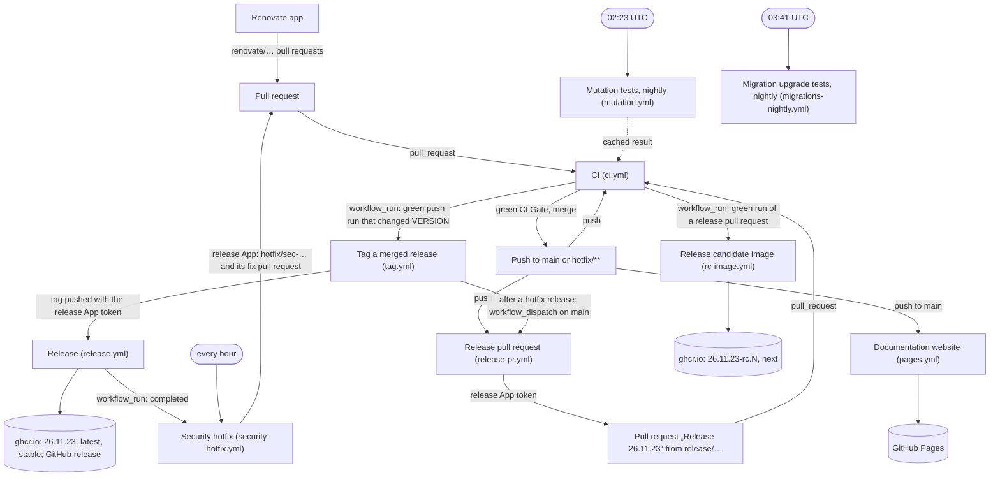
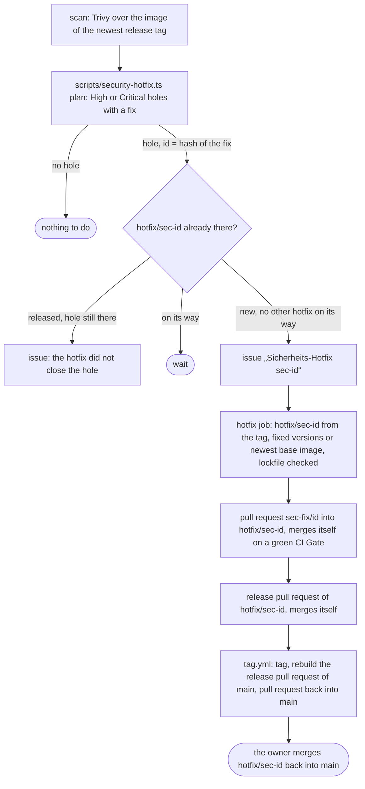

Nine workflows in `.github/workflows/` and the Renovate app carry a change
from a pull request to a published image. The decisions behind them are in
[Branching and release](/okf/ops/branching-release.md); the step by step
view of a release is in [Git workflow](git-workflow.md).

## How they fit together

Only the release App's token starts further workflows: a pull request or a
tag created with `GITHUB_TOKEN` starts none. That is why the release pull
request, the tag and the security hotfix use the App, whose key is a secret
of the environment `release`, available only to jobs on `main` and
`hotfix/**`.

## What each workflow does

| Workflow                                                    | Starts on                                                                                                     | Produces                                                                                                                                                                                                                                                                                                 |
| ----------------------------------------------------------- | ------------------------------------------------------------------------------------------------------------- | -------------------------------------------------------------------------------------------------------------------------------------------------------------------------------------------------------------------------------------------------------------------------------------------------------- |
| CI (`ci.yml`)                                               | Every pull request; pushes to `main` and `hotfix/**`.                                                         | The check „CI Gate“, required on `main` ([CI and checks](ci.md)).                                                                                                                                                                                                                                        |
| Release pull request (`release-pr.yml`)                     | Pushes to `main` and `hotfix/**`; by hand. Only with the variable `RELEASE_APP_ID`.                           | The branch `release/<branch>`, rebuilt from the branch, and the pull request „Release <version>“ with the `CHANGELOG.md` section, the next `VERSION`, the pull requests since the last tag and a checklist; closed when nothing is new. A release pull request of `hotfix/sec-…` is set to merge itself. |
| Release candidate image (`rc-image.yml`)                    | A green CI run of a pull request from `release/…` of this repository, pushed by `nova-imperium-release[bot]`. | The image `<version>-rc.<N>` for linux/amd64 and linux/arm64, and `next` while the run is the head of the release branch.                                                                                                                                                                                |
| Tag a merged release (`tag.yml`)                            | A green CI push run on `main` or `hotfix/**`.                                                                 | When the commit changed `VERSION`: the annotated tag `<version>` (`scripts/release.sh`). After a hotfix release: the release pull request of `main` rebuilt, and for `hotfix/sec-…` the pull request „Sicherheits-Hotfix <version> zurück nach main“.                                                    |
| Release (`release.yml`)                                     | A pushed tag `YY.M.MICRO`; by hand as a dry run that builds without publishing.                               | After checking that CI passed for the tagged commit: the image `<version>` for linux/amd64 and linux/arm64, the GitHub release with the German changelog section, and `latest` and `stable` pointed at the newest release tag.                                                                           |
| Security hotfix (`security-hotfix.yml`)                     | Every hour at minute 17; after every run of „Release“; by hand.                                               | See below.                                                                                                                                                                                                                                                                                               |
| Mutation tests, nightly (`mutation.yml`)                    | 02:23 UTC; by hand.                                                                                           | The complete Stryker run on `main` with the per-file floors; the cached result the incremental runs start from.                                                                                                                                                                                          |
| Migration upgrade tests, nightly (`migrations-nightly.yml`) | 03:41 UTC; by hand.                                                                                           | The upgrade test of every migration with a random seed and 1000 generated databases.                                                                                                                                                                                                                     |
| Documentation website (`pages.yml`)                         | Every push to `main`; by hand.                                                                                | This site on GitHub Pages (environment `github-pages`); one deployment at a time.                                                                                                                                                                                                                        |

Renovate is an app, not a workflow: its `renovate/…` pull requests go
through the CI like any other, and patch updates merge themselves when the
CI Gate is green ([Git workflow](git-workflow.md#renovate)).

## Security hotfix

A hole rated High or Critical in the published release goes to `stable` at
once, as a hotfix of the last release tag without the unreleased work of
`main` ([Branching and release](/okf/ops/branching-release.md#security-hotfix-owner-2026-11-12)).

- The scan rates npm packages by the higher of GitHub's rating and
  Trivy's own; everything else by Trivy.
- The fix is applied again on the release tag, not cherry-picked: pnpm
  overrides and fixed versions for npm packages, the newest digest of
  `node:26-slim` and fresh Debian updates (`OS_UPDATES`) for the base image;
  the fragment says „Sicherheitsupdate“ without package names.
- One hotfix at a time: a second one from the same tag would release
  without the first fix. A release older than the release pull request
  (26.11.18 and older) gets no automatic hotfix; an issue says to release
  `main` instead.
- While a released hotfix is not merged back, the release pull request of
  `main` stays a draft: its release would drop the fix from `stable`.

## Settings the automation needs

From [Branching and release](/okf/ops/branching-release.md) (tasks of the
owner) and [Operations](/docs/operations.md#releases): the release GitHub
App with „Contents“ and „Pull requests“ read and write and the variable
`RELEASE_APP_ID`; the environment `release` with the deployment branches
`main` and `hotfix/**` and the secret `RELEASE_APP_PRIVATE_KEY`; „CI Gate“
as the required check of `main`; the rulesets „hotfix“ and
„hotfix-anlegen“; the label `kein-changelog`; „Allow auto-merge“;
Dependabot alerts on and Dependabot security updates off; the Renovate app;
GitHub Pages with the source „GitHub Actions“ for this site.
