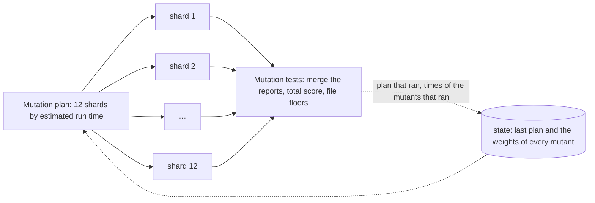

The CI is `.github/workflows/ci.yml`. It runs on every pull request (opened,
updated, reopened, labeled, unlabeled), on every push to `main` and
`hotfix/**`, and every night on `main`. Pushes run the full suite, except a
job proven on the same content (see below); a pull request runs what its
changes need; a release pull request runs only the cheap checks. One job,
**CI Gate**, collects the results and is the only required check of `main`. The rules behind it are in
[Test strategy](/okf/ops/testing.md) and
[Branching and release](/okf/ops/branching-release.md).

## The jobs

| Job                                          | What it checks                                                                                                                                                                                                                                                                                                                                                                                                                                                                        | When it runs                                                                                                                                                                                                                    |
| -------------------------------------------- | ------------------------------------------------------------------------------------------------------------------------------------------------------------------------------------------------------------------------------------------------------------------------------------------------------------------------------------------------------------------------------------------------------------------------------------------------------------------------------------- | ------------------------------------------------------------------------------------------------------------------------------------------------------------------------------------------------------------------------------- |
| Detect changes                               | Decides from the changed files whether the code checks, the Docker image and the website run (see below).                                                                                                                                                                                                                                                                                                                                                                             | Always.                                                                                                                                                                                                                         |
| Changelog fragments                          | Every fragment in `changes/` is well-formed; a pull request that changes `src/client`, `src/core`, `src/features`, `src/server/game` or `src/server/http` brings one, unless it has the label `kein-changelog` (`scripts/changelog.ts check`).                                                                                                                                                                                                                                        | Pull requests.                                                                                                                                                                                                                  |
| Lint, types, unit tests with coverage, build | ESLint with `--max-warnings 0`, knip, jscpd, dependency-cruiser, Prettier, `svelte-check`, Vitest with coverage (blocks below 90 % lines and 85 % branches), `vite build`.                                                                                                                                                                                                                                                                                                            | When the code changes.                                                                                                                                                                                                          |
| E2E tests (part N)                           | Playwright in Chromium against the real server, split into 4 parts (matrix 1 to 4, `fail-fast: false`): each part starts its own servers with their own data and runs its share of the spec files (`scripts/e2e-shards.ts` with the plan `e2e/shards.json`, balanced by measured times; a new spec goes to the part its name hashes to). The game flows on desktop and phone size, accessibility with axe; a failed part keeps its report as `playwright-report-part-<N>` for 7 days. | When the code changes.                                                                                                                                                                                                          |
| E2E tests (browser)                          | Every part succeeded; the CI Gate and the proofs of a push see this one job.                                                                                                                                                                                                                                                                                                                                                                                                          | When the code changes, also when a part failed.                                                                                                                                                                                 |
| Mutation plan                                | Splits the files Stryker mutates into 12 shards (`SHARDS` in `scripts/mutation-shards.ts`) by their estimated run time, every file on its shard of the last plan; a file without a weight costs as much as the mean file with one (`scripts/mutation-shards.ts plan`); the plan and the shard numbers are the job's outputs.                                                                                                                                                          | Hotfix push or pull request, a pull request that changes the mutation configuration or test tool chain, or a pull request with a non-empty partial set while the last nightly run is red or missing; never on a push to `main`. |
| Mutation tests (shard N of 12)               | Stryker on the files of one shard (matrix 1 to 12 from the plan, `fail-fast: false`), incremental with the shard's own cache; uploads the shard's report.                                                                                                                                                                                                                                                                                                                             | Hotfix push or pull request, a pull request that changes the mutation configuration or test tool chain, or a pull request with a non-empty partial set while the last nightly run is red or missing; never on a push to `main`. |
| Mutation tests                               | Merges the shard reports and checks them as one run: every shard ran once with exactly its files, the total score is at least 80 % (`stryker.config.json`), no file is below its floor (`mutation-floors.txt`, `scripts/mutation-gate.ts`); keeps the merged report as the artifact `mutation-report`.                                                                                                                                                                                | Hotfix push or pull request, a pull request that changes the mutation configuration or test tool chain, or a pull request with a non-empty partial set while the last nightly run is red or missing; never on a push to `main`. |
| Mutation tests (changed files, part N of M)  | In a pull request that is no release pull request and goes into no hotfix branch: Stryker on one part of the changed files of the `mutate` globs and the sources of the changed test files (`scripts/mutation-partial.ts`), about 12 files a part, split by the weights of the last complete run, without any cache; uploads the report of the part.                                                                                                                                  | When the pull request changes such a file (a non-empty partial set), not the mutation configuration or the test tool chain, and the last nightly run is green.                                                                  |
| Mutation tests (changed files)               | Merges the reports of the parts (every part ran once with exactly its files, `scripts/mutation-partial.ts merge`) and checks every file at or above its floor, no total score (`scripts/mutation-gate.ts --partial`).                                                                                                                                                                                                                                                                 | When the pull request changes such a file (a non-empty partial set), not the mutation configuration or the test tool chain, and the last nightly run is green.                                                                  |
| Docker image and Compose stack               | `compose.yaml` is valid and requires `NOVA_PUBLIC_URL`; the last release writes data, the image built from the `Dockerfile` starts on the same volume and the data survive (`docker/upgrade.sh`); Trivy; no compiler, package manager or tests in the image; a wrong setting stops the start; the smoke test (`docker/smoke.sh`).                                                                                                                                                     | When **image** is true (see below).                                                                                                                                                                                             |
| Secrets and dependencies                     | gitleaks over the whole history (exceptions in `.gitleaksignore`); `pnpm audit --prod --audit-level high`.                                                                                                                                                                                                                                                                                                                                                                            | Always.                                                                                                                                                                                                                         |
| Migrations append-only                       | No released migration was moved, removed or changed, compared with the base of the pull request, the previous tip of the branch, or for a new hotfix branch the release tag it starts from (`.github/scripts/migrations-gate.mjs`).                                                                                                                                                                                                                                                   | Always.                                                                                                                                                                                                                         |
| Workflow lint                                | actionlint (syntax, expressions, shell) and zizmor (security, for example unpinned actions or persisted credentials) over `.github/workflows`.                                                                                                                                                                                                                                                                                                                                        | Always.                                                                                                                                                                                                                         |
| ReDoS lint                                   | `pnpm lint:redos`: the rule `redos/no-vulnerable` of `eslint-plugin-redos` (`eslint.redos.config.js`) over every file `eslint .` covers; a polynomial or exponential regular expression in production code or `scripts/`, an exponential one in tests, and a check that times out (30 s) fail. The ESLint cache is kept per lockfile and configuration.                                                                                                                               | Always.                                                                                                                                                                                                                         |
| CodeQL                                       | `security-extended` queries over JavaScript and TypeScript; a finding of security severity 7.0 or more, or of level „error“, fails (`.github/scripts/codeql-gate.mjs`).                                                                                                                                                                                                                                                                                                               | Always: the ruleset of `main` waits for a CodeQL result of the exact commit.                                                                                                                                                    |
| Documentation website                        | Prettier over `website/`, the entries of the update log in `okf/log/` (`scripts/okf-log.ts check`), its tests (`pnpm test`, `node:test`), then the build of this site from `website/`, `okf/` and `docs/`; every internal link and anchor must resolve.                                                                                                                                                                                                                               | When the website or its sources change.                                                                                                                                                                                         |
| CI Gate                                      | Evaluates every job above (next section).                                                                                                                                                                                                                                                                                                                                                                                                                                             | Always, also when a job failed or was skipped.                                                                                                                                                                                  |

## How „Detect changes“ decides

A push to `main` or `hotfix/**` sets everything to true, except that a push
to `main` runs no mutation job (`mutation=nightly`: the result of the pull
request counts; without a proof only the next nightly run tests `main`, as
it is that night, not necessarily the tree of that push, #370); a
job that already succeeded on the same content is skipped with its proof
(next section). The
nightly run sets everything to true except the mutation jobs, which
`mutation.yml` runs the same night. A pull request into `main` whose head
does not contain the base commit of its event fails at once, before any
expensive job, with the fix in its message (`git fetch origin && git merge
origin/main`, then push; #431); a pull request into `hotfix/**` and a release
pull request are left out. A pull request compares its changes with its
base:

- **code** is true when a file outside `okf/`, `docs/`, `changes/` and
  `website/` changes, except Markdown files at the top level. A pull request
  that only changes documentation, decisions, fragments or the website runs
  no lint, unit, E2E or mutation tests.
- **image** is true when the image, its start or the upgrade can change:
  `Dockerfile`, `.dockerignore`, `compose*.yaml`, `docker/`, `package.json`,
  `pnpm-lock.yaml`, `.node-version`, the database code (`src/server/db/`),
  the server start (`main.ts`, `server.ts`, `config.ts`, `cli.ts`,
  `maintenance.ts` in `src/server/`) and `ci.yml` itself. Game code alone
  does not build the image in its pull request; every push to `main`
  (unless proven on the same content) and the nightly run do.
- **site** is true when `website/`, `okf/`, `docs/`, `scripts/okf-log.ts`,
  `ci.yml` or `pages.yml` change.
- Every pull request **into `hotfix/…`** sets all three: it leads straight
  to a release.
- A **release pull request** (head `release/main` or `release/hotfix/*`)
  may change only `VERSION`, `CHANGELOG.md` and `changes/`; any other file
  fails „Detect changes“. It sets every output to false: no unit tests,
  E2E, mutation, image or website, only the jobs that run for every change
  and „Changelog fragments“. It relies on the results of its base (#387).

## How the CI Gate decides

The gate runs with `if: always()` and fails unless:

1. „Detect changes“, „Secrets and dependencies“, „Migrations append-only“,
   „Workflow lint“, „ReDoS lint“ and „CodeQL“ succeeded – for every change,
   documentation included;
2. on a push, all outputs are true – pushes run the full suite, and a job
   is skipped only with its proof (next section) – except **mutation** on a
   push to `main`, which is `nightly`; in the nightly run, all are true
   except the mutation jobs, which must not run;
3. on a pull request, „Changelog fragments“ succeeded;
4. when **code** is true: the lint/unit job and the E2E tests succeeded;
   when it is false, they may be skipped („Documentation-only change“);
   the mutation jobs follow the output **mutation**: `true` (a push to
   `hotfix/**`, a pull request into a hotfix branch, a change of the
   mutation configuration, `mutation-standard.json` included, or the test
   tool chain, or a pull request with a non-empty partial set while the last
   nightly run is red or missing): „Mutation plan“, every shard of
   „Mutation tests (shard N of 12)“ and the gate „Mutation tests“
   succeeded; `partial` (every other pull request that changes a mutated
   file or the source of a test): every part of „Mutation tests (changed
   files, part N of M)“ and the merge and gate job „Mutation tests (changed
   files)“ succeeded and the shards were skipped; `nightly` (a push to
   `main`): every mutation job, the shards and the parts, was skipped, and
   the gate prints the proof of the pull request or that the nightly run
   tests `main`; `false` (nothing to mutate, a release pull request, the
   nightly run) and `reuse` (the head only merged `main`) as before; the
   gate prints the nightly run „Detect changes“ looked at;
5. when **image** is true: „Docker image and Compose stack“ succeeded;
6. when **site** is true: „Documentation website“ succeeded;
7. on a release pull request, every output is false: it refuses an
   expensive job.

A missing or invalid output of „Detect changes“ fails the gate. A skipped job
counts only where the gate expects the skip.

## Proofs of a push

A push to `main` or `hotfix/**` skips an expensive job (the lint/unit job,
the E2E tests, the mutation run, the image with the Compose stack, the
website) that already succeeded on the same content
(`scripts/already-tested.ts`); the CI Gate names the run and the job of
each proof. Every other case, and every error of the lookup, runs
everything, except the mutation jobs of a push to `main`: they never run
there (#370, 200a), and without a proof the gate says that the nightly run
tests `main`.

- **Merge of a pull request** (#342): the pushed commit merged one pull
  request whose green CI run tested a head with the identical Git tree; each
  job that succeeded there is proven.
- **Merge of a release pull request** (#387): a push that changes only
  `VERSION`, `CHANGELOG.md` and `changes/` against its first parent takes
  over the proofs of that parent's green push run: every job that succeeded
  there, or was skipped there with its own proof.

## Mutation tests

Complete mutation runs are split into 12 parallel jobs (6 until
2026-11-20): pushes to `hotfix/**` (incremental), a pull request into a
hotfix branch, a pull request that changes the mutation configuration or
the test tool chain, a pull request with a non-empty partial set while the
last nightly run is red or missing, and the nightly run (complete). A push
to `main` runs no shards (#370). Every other pull request mutates only the
files it changes, in up to 12 parts of about 12 files (see „Partial run of a
pull request“ below). The decisions and the details of the code are in
[Test strategy](/okf/ops/testing.md); the script is
`scripts/mutation-shards.ts`.

- **Plan.** `scripts/mutation-shards.ts plan` lists the files of the
  `mutate` globs of `stryker.config.json` and weighs each by the test time
  of its mutants in the weights of the last run (cache `stryker-state-…`,
  with the plan that ran). Without one, in the merged report of the last
  **complete** run (cache `stryker-weights-…`, saved by the nightly run), else in the last merged report
  (`stryker-report-…`). A file the weights do not know (new since that
  run) weighs as much as the mean file that has a weight, because no cheap
  property of a file predicts its time better (see „Test strategy“); only
  without any weight does it weigh by its lines. A file of the plan that
  the report leaves out has no mutants and weighs 0 from then on. The
  first run of a branch plans with the weights of `main`, so its new files
  are guesses; the next run of the same ref plans with the measured times.
- **Shard number.** `SHARDS` in `scripts/mutation-shards.ts` is the only
  place that holds it (12; 6 until 2026-11-20). The plan job prints the
  shard numbers as a second output, and the matrix and the names of the
  shard jobs in `ci.yml` and `mutation.yml` follow it. A previous plan of
  another number of shards is not used: the first run after a change plans
  from the weights alone and tests the files of the moved shards again.
- **Stable shards.** Every file stays on its shard of the last plan, so
  the shard keeps its cached results; new files go onto the lightest
  shard. Only a shard above 1.5 times the mean weight gives files to the
  lightest one (#141). Without a last plan the heaviest files go first
  onto the emptiest shard.
- **Weights.** After the merge, `scripts/mutation-shards.ts weights` takes
  the test time of every mutant this run ran; a mutant whose result
  Stryker took over has no time and keeps its old one. The gate job keeps
  the plan and the weights for the next plan.
- **Cut files.** A TypeScript file heavier than half a shard is cut into
  line ranges between its top-level statements (`file:from-to`); Stryker
  mutates a node only when it lies wholly in one range, and no node spans
  two top-level statements, so no mutant is lost.
- **Shards.** Each shard writes its own Stryker configuration
  (`scripts/mutation-shards.ts config <n>`: only its files, no break
  threshold) and keeps its own incremental result in the cache
  `stryker-shard<N>-<ref>-<sha>`, restored from the same shard on the same
  branch, else on `main`; unchanged code keeps its cached result. The first run after a file
  moves to another shard tests it again there.
- **Static mutants.** Before the incremental run,
  `scripts/mutation-shards.ts drop-static` removes the cached results of
  the static mutants (code run when its module loads, tested by every
  test), so they always run again:
  Stryker would keep their old result even when a new test kills them
  (#201). Every other result stays cached.
- **Merge and gate.** `scripts/mutation-shards.ts merge` fails unless every
  shard of the plan ran exactly once and reported only its own files, no
  mutant is in two reports and the ranges of a cut file cover it without
  gap or overlap. `scripts/mutation-gate.ts --report` then checks the
  merged report: a total below 80 % fails, and so does a file below its
  floor. The gate keeps the merged report for the next plan.
- **Partial run of a pull request.** `scripts/mutation-partial.ts plan`
  lists the files of the `mutate` globs that the pull request changed and
  the source of each changed test file (the same name without `.test`, also
  without a dotted suffix such as `.property`, with the ending `.svelte.ts`,
  and in `src/test/` the script of the same name), and every file whose
  floor in `mutation-floors.txt` the pull request adds, changes or
  removes (a change of `mutation-standard.json` runs everything), at any
  number of files (#370). `scripts/mutation-partial.ts parts` splits them
  into one part for each 12 files begun, at most 12, by the weights of the
  last complete run (restored read only from the cache of `main`), else by
  their lines. The jobs „Mutation tests (changed files, part N of M)“
  mutate every mutant of their files without the incremental file and
  without any cache, so a partial result never reaches the plans, the
  weights or the cached results of the shards; „Mutation tests (changed
  files)“ merges their reports and `scripts/mutation-gate.ts --partial`
  checks each file against its floor (80 % without one), with no total
  score. A test without such a source and a test helper add nothing; the
  nightly run tests them. While the last nightly complete run on `main` is
  red or missing (`scripts/mutation-nightly.ts`; every error of the lookup
  counts as missing), a pull request into `main` with a non-empty set runs
  the complete 12 shards instead, and the CI Gate prints the run it looked
  at.
- **Complete runs.** Every night (`mutation.yml`, 02:23 UTC, 12 shards
  like the CI). When the nightly gate fails
  on `main`, the run opens the issue „Mutation floor missed on main“ with the
  files below their floor, or updates the open one. Stryker's incremental mode
  notices only changes in mutated files and tests, not in helpers or
  configuration; the complete run catches what it misses.
- **Mutated**: `src/core`, `src/features`, `src/server` and
  `src/client/logic`, without the tests, the process entry points, the test
  helpers and the display texts of `src/core/texts.ts` and
  `src/features/<key>/texts.de.ts`
  (`stryker.config.json`).
- **Per-file floors** (`mutation-floors.txt`, one line per file; the rest of
  the standard in `mutation-standard.json`): no file may fall below its
  recorded floor; a new file needs 80 %, a security file (authentication,
  sessions, passkeys, admin rights, moderation, account deletion, audit,
  request limits, the error log) 90 %. The floors come from the merged report of
  a complete CI run only (the artifact `mutation-report`): `node
scripts/mutation-floors.ts <report.json>` raises them to the measured
  scores and never lowers one; local Stryker runs only find survivors.

## Trivy

Trivy scans the image built in „Docker image and Compose stack“, holes with a
fix only, and `scripts/trivy-gate.ts` decides:

| Run                                                | Blocks on                                                                                                                                                                                                      |
| -------------------------------------------------- | -------------------------------------------------------------------------------------------------------------------------------------------------------------------------------------------------------------- |
| Pull request into `hotfix/**`, push to `hotfix/**` | Every High and Critical hole.                                                                                                                                                                                  |
| Push to `main`, the nightly run                    | Every Critical hole.                                                                                                                                                                                           |
| Any other pull request                             | Only the Critical holes it brings in: the image of the base branch is built and scanned too, and its holes are left out, so two Renovate pull requests that each fix one of two holes do not block each other. |

A release pull request builds no image, so it runs no Trivy. The release
image itself is scanned by `release.yml` for every High and Critical hole
with a fix, each platform on its own, before `latest` and `stable` move; a
finding leaves them on the previous release
([Branching and release](/okf/ops/branching-release.md)).

The published release is scanned again every hour by the workflow
„Security hotfix“ ([Automation](automation.md#security-hotfix)).

## Secrets, dependencies and code scanning

- **gitleaks** scans the whole Git history. A finding that is no secret (a
  sample value in a test) is removed from the code; if it stays in the
  history, its fingerprint `commit:file:rule:line` goes into
  `.gitleaksignore`, named in the pull request.
- **pnpm audit** blocks known High and Critical holes in the production
  dependencies of the game.
- **CodeQL** runs the `security-extended` queries with the full analysis on
  pull requests and `main` alike.
- **ReDoS lint**: no regular expression that takes polynomial time (in
  tests: exponential time) on a hostile input; a finding is fixed by
  rewriting the expression, with a test that it behaves as before (#367).
- **Workflow lint**: every action is pinned to a commit hash with its
  version as a comment, and checkouts keep no credentials unless the job
  pushes.

## Nightly runs

| Workflow                                                    | When                  | What                                                                                                                                                                                                                                                                                                                                                                                                                                                                                       |
| ----------------------------------------------------------- | --------------------- | ------------------------------------------------------------------------------------------------------------------------------------------------------------------------------------------------------------------------------------------------------------------------------------------------------------------------------------------------------------------------------------------------------------------------------------------------------------------------------------------ |
| CI (nightly), `ci.yml`                                      | 01:07 UTC             | The scheduled run on `main`: the unit suite, the E2E suite, the image with the Compose stack and the upgrade test, and the website; no mutation jobs, `mutation.yml` runs them the same night.                                                                                                                                                                                                                                                                                             |
| Mutation tests (nightly), `mutation.yml`                    | 02:23 UTC, or by hand | The complete Stryker run on `main` in 12 shards with the same plan and gate as the CI; it saves the merged report (`stryker-weights-…`) and the plan with the weights of every mutant (`stryker-state-…`) for the next plans and keeps it as the artifact `mutation-report` for 30 days. When the gate fails on `main`, it opens or updates the issue „Mutation floor missed on main“ with the files below their floor. „Run workflow“ on another branch runs the same complete run there. |
| Migration upgrade tests (nightly), `migrations-nightly.yml` | 03:41 UTC, or by hand | The property-based upgrade test of every migration with a random seed and 1000 generated databases each; pull requests run 100 with a fixed seed. A failure prints the seed: `MIGRATION_SEED=<seed> pnpm vitest run src/server/db/migrations.property.test.ts`.                                                                                                                                                                                                                            |

The release loop looks at the nightly failures first and fixes them through
a pull request into `main` before other work
([Release loop](/okf/ops/loop.md)).

## CodeRabbit

CodeRabbit is not a job of the CI but a review app (`.coderabbit.yaml`). It
reviews every pull request once, when it is opened or marked ready – not
drafts, not later pushes – in English with the profile „chill“, comments
and never requests changes. It skips `pnpm-lock.yaml`, the frozen version 1,
`docs/design/` and SVG files, and has instructions per path: security first
in `src/server`, pure rules in `src/core`, features that import no other
feature in `src/features`, German texts and the
Content-Security-Policy in `src/client`, append-only migrations, pinned
actions, the German changelog texts and the OKF markers. Which findings
block a merge is rule O4 ([Git workflow](git-workflow.md#the-pull-request-flow)).

## Run the checks locally

`pnpm check` runs what the job „Lint, types, unit tests with coverage,
build“ runs. The commands of every other check are in
[Development](/docs/development.md#checks); the website builds with
`pnpm build` in `website/`.
