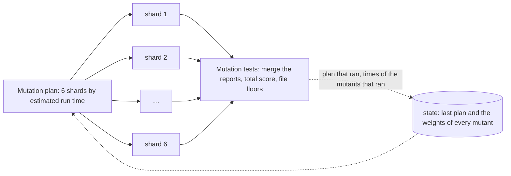

The CI is `.github/workflows/ci.yml`. It runs on every pull request (opened,
updated, reopened, labeled, unlabeled) and on every push to `main` and
`hotfix/**`. Pushes run the full suite; a pull request runs what its changes
need. One job, **CI Gate**, collects the results and is the only required
check of `main`. The rules behind it are in
[Test strategy](/okf/ops/testing.md) and
[Branching and release](/okf/ops/branching-release.md).

## The jobs

| Job                                          | What it checks                                                                                                                                                                                                                                                                                                                    | When it runs                                                                 |
| -------------------------------------------- | --------------------------------------------------------------------------------------------------------------------------------------------------------------------------------------------------------------------------------------------------------------------------------------------------------------------------------- | ---------------------------------------------------------------------------- |
| Detect changes                               | Decides from the changed files whether the code checks, the Docker image and the website run (see below).                                                                                                                                                                                                                         | Always.                                                                      |
| Changelog fragments                          | Every fragment in `changes/` is well-formed; a pull request that changes `src/client`, `src/core`, `src/features` or `src/server/game` brings one, unless it has the label `kein-changelog` (`scripts/changelog.ts check`).                                                                                                       | Pull requests.                                                               |
| Lint, types, unit tests with coverage, build | ESLint with `--max-warnings 0`, knip, jscpd, dependency-cruiser, Prettier, `svelte-check`, Vitest with coverage (blocks below 90 % lines and 85 % branches), `vite build`.                                                                                                                                                        | When the code changes.                                                       |
| E2E tests (browser)                          | Playwright in Chromium against the real server: the game flows on desktop and phone size, accessibility with axe; the report is kept 7 days when it fails.                                                                                                                                                                        | When the code changes.                                                       |
| Mutation plan                                | Splits the files Stryker mutates into 6 shards by their estimated run time, every file on its shard of the last plan (`scripts/mutation-shards.ts plan`); the plan is the job's output.                                                                                                                                           | When the code changes.                                                       |
| Mutation tests (shard N of 6)                | Stryker on the files of one shard (matrix 1 to 6, `fail-fast: false`), incremental with the shard's own cache, complete (`--force`) in a release pull request; uploads the shard's report.                                                                                                                                        | When the code changes.                                                       |
| Mutation tests                               | Merges the six reports and checks them as one run: every shard ran once with exactly its files, the total score is at least 80 % (`stryker.config.json`), no file is below its floor (`mutation-standard.json`, `scripts/mutation-gate.ts`).                                                                                      | When the code changes.                                                       |
| Docker image and Compose stack               | `compose.yaml` is valid and requires `NOVA_PUBLIC_URL`; the last release writes data, the image built from the `Dockerfile` starts on the same volume and the data survive (`docker/upgrade.sh`); Trivy; no compiler, package manager or tests in the image; a wrong setting stops the start; the smoke test (`docker/smoke.sh`). | When **image** is true (see below).                                          |
| Secrets and dependencies                     | gitleaks over the whole history (exceptions in `.gitleaksignore`); `pnpm audit --prod --audit-level high`.                                                                                                                                                                                                                        | Always.                                                                      |
| Migrations append-only                       | No released migration was moved, removed or changed, compared with the base of the pull request, the previous tip of the branch, or for a new hotfix branch the release tag it starts from (`.github/scripts/migrations-gate.mjs`).                                                                                               | Always.                                                                      |
| Workflow lint                                | actionlint (syntax, expressions, shell) and zizmor (security, for example unpinned actions or persisted credentials) over `.github/workflows`.                                                                                                                                                                                    | Always.                                                                      |
| CodeQL                                       | `security-extended` queries over JavaScript and TypeScript; a finding of security severity 7.0 or more, or of level „error“, fails (`.github/scripts/codeql-gate.mjs`).                                                                                                                                                           | Always: the ruleset of `main` waits for a CodeQL result of the exact commit. |
| Documentation website                        | Prettier over `website/`, its tests (`pnpm test`, `node:test`), then the build of this site from `website/`, `okf/` and `docs/`; every internal link and anchor must resolve.                                                                                                                                                     | When the website or its sources change.                                      |
| CI Gate                                      | Evaluates every job above (next section).                                                                                                                                                                                                                                                                                         | Always, also when a job failed or was skipped.                               |

## How „Detect changes“ decides

A push to `main` or `hotfix/**` sets everything to true. A pull request
compares its changes with its base:

- **code** is true when a file outside `okf/`, `docs/`, `changes/` and
  `website/` changes, except Markdown files at the top level. A pull request
  that only changes documentation, decisions, fragments or the website runs
  no lint, unit, E2E or mutation tests.
- **image** is true when the image, its start or the upgrade can change:
  `Dockerfile`, `.dockerignore`, `compose*.yaml`, `docker/`, `package.json`,
  `pnpm-lock.yaml`, `.node-version`, the database code (`src/server/db/`),
  the server start (`main.ts`, `server.ts`, `config.ts`, `cli.ts`,
  `maintenance.ts` in `src/server/`) and `ci.yml` itself. Game code alone
  does not build the image in its pull request; every push to `main` and
  the release pull request do.
- **site** is true when `website/`, `okf/`, `docs/`, `ci.yml` or `pages.yml`
  change.
- A **release pull request** (head `release/…`) and every pull request
  **into `hotfix/…`** set all three: they lead straight to a release.

## How the CI Gate decides

The gate runs with `if: always()` and fails unless:

1. „Detect changes“, „Secrets and dependencies“, „Migrations append-only“,
   „Workflow lint“ and „CodeQL“ succeeded – for every change,
   documentation included;
2. on a push, all three outputs are true – pushes always run the full suite;
3. on a pull request, „Changelog fragments“ succeeded;
4. when **code** is true: the lint/unit job, the E2E tests, „Mutation plan“,
   every shard of „Mutation tests (shard N of 6)“ and the gate „Mutation
   tests“ succeeded; when it is false, they may be skipped
   („Documentation-only change“);
5. when **image** is true: „Docker image and Compose stack“ succeeded;
6. when **site** is true: „Documentation website“ succeeded.

A missing or invalid output of „Detect changes“ fails the gate. A skipped job
counts only where the gate expects the skip.

## Mutation tests

Mutation runs are split into 6 parallel jobs everywhere: pull requests and
pushes to `main` (incremental), the release pull request and the nightly
run (complete). The decisions and the details of the code are in
[Test strategy](/okf/ops/testing.md); the script is
`scripts/mutation-shards.ts`.

- **Plan.** `scripts/mutation-shards.ts plan` lists the files of the
  `mutate` globs of `stryker.config.json` and weighs each by the test time
  of its mutants in the weights of the last run (cache `stryker-state-…`,
  with the plan that ran). Without one, in the merged report of the last
  **complete** run (cache `stryker-weights-…`, saved by the nightly run and
  by a release pull request), else in the last merged report
  (`stryker-report-…`). A file the weights do not know weighs by its lines.
- **Stable shards.** Every file stays on its shard of the last plan, so
  the shard keeps its cached results; new files go onto the lightest
  shard. Only a shard above 1.5 times the mean weight gives files to the
  lightest one (#141). Without a last plan the heaviest files go first
  onto the emptiest shard.
- **Weights.** After the merge, `scripts/mutation-shards.ts weights` takes
  the test time of every mutant this run ran; a mutant whose result
  Stryker took over has no time and keeps its old one. The gate job keeps
  the plan and the weights for the next plan.
- **Cut files.** A TypeScript file heavier than half a shard is cut into
  line ranges between its top-level statements (`file:from-to`); Stryker
  mutates a node only when it lies wholly in one range, and no node spans
  two top-level statements, so no mutant is lost.
- **Shards.** Each shard writes its own Stryker configuration
  (`scripts/mutation-shards.ts config <n>`: only its files, no break
  threshold) and keeps its own incremental result in the cache
  `stryker-shard<N>-<ref>-<sha>`, restored from the same shard on the same
  branch, else on `main`; unchanged code keeps its cached result. A release
  pull request runs every mutant (`--force`). The first run after a file
  moves to another shard tests it again there.
- **Merge and gate.** `scripts/mutation-shards.ts merge` fails unless every
  shard of the plan ran exactly once and reported only its own files, no
  mutant is in two reports and the ranges of a cut file cover it without
  gap or overlap. `scripts/mutation-gate.ts --report` then checks the
  merged report: a total below 80 % fails, and so does a file below its
  floor. The gate keeps the merged report for the next plan.
- **Complete runs.** Every night (`mutation.yml`, 02:23 UTC, 6 shards
  like the CI) and in a release pull request. Stryker's incremental mode
  notices only changes in mutated files and tests, not in helpers or
  configuration; the complete run catches what it misses.
- **Mutated**: `src/core`, `src/features`, `src/server` and
  `src/client/logic`, without the tests, the process entry points, the test
  helpers and the display texts of `src/core/texts.ts` and
  `src/features/<key>/texts.de.ts`
  (`stryker.config.json`).
- **Per-file floors** (`mutation-standard.json`): no file may fall below its
  recorded floor; a new file needs 80 %, a security file (authentication,
  sessions, passkeys, admin rights, moderation, account deletion, audit,
  request limits, the error log) 90 %. `node scripts/mutation-gate.ts
--update` raises the floors to the current scores; it never lowers one.

## Trivy

Trivy scans the image built in „Docker image and Compose stack“, holes with a
fix only, and `scripts/trivy-gate.ts` decides:

| Run                                                                      | Blocks on                                                                                                                                                                                                      |
| ------------------------------------------------------------------------ | -------------------------------------------------------------------------------------------------------------------------------------------------------------------------------------------------------------- |
| Release pull request, pull request into `hotfix/**`, push to `hotfix/**` | Every High and Critical hole.                                                                                                                                                                                  |
| Push to `main`                                                           | Every Critical hole.                                                                                                                                                                                           |
| Any other pull request                                                   | Only the Critical holes it brings in: the image of the base branch is built and scanned too, and its holes are left out, so two Renovate pull requests that each fix one of two holes do not block each other. |

The published release is scanned again every hour by the workflow
„Security hotfix“ ([Automation](automation.md#security-hotfix)).

## Secrets, dependencies and code scanning

- **gitleaks** scans the whole Git history. A finding that is no secret (a
  sample value in a test) is removed from the code; if it stays in the
  history, its fingerprint `commit:file:rule:line` goes into
  `.gitleaksignore`, named in the pull request.
- **pnpm audit** blocks known High and Critical holes in the production
  dependencies of the game.
- **CodeQL** runs the `security-extended` queries with the full analysis on
  pull requests and `main` alike.
- **Workflow lint**: every action is pinned to a commit hash with its
  version as a comment, and checkouts keep no credentials unless the job
  pushes.

## Nightly runs

| Workflow                                                    | When                  | What                                                                                                                                                                                                                                                                                                                                                       |
| ----------------------------------------------------------- | --------------------- | ---------------------------------------------------------------------------------------------------------------------------------------------------------------------------------------------------------------------------------------------------------------------------------------------------------------------------------------------------------- |
| Mutation tests (nightly), `mutation.yml`                    | 02:23 UTC, or by hand | The complete Stryker run on `main` in 6 shards with the same plan and gate as the CI; it saves the merged report (`stryker-weights-…`) and the plan with the weights of every mutant (`stryker-state-…`) for the next plans and keeps it as the artifact `mutation-report` for 30 days. „Run workflow“ on another branch runs the same complete run there. |
| Migration upgrade tests (nightly), `migrations-nightly.yml` | 03:41 UTC, or by hand | The property-based upgrade test of every migration with a random seed and 1000 generated databases each; pull requests run 100 with a fixed seed. A failure prints the seed: `MIGRATION_SEED=<seed> pnpm vitest run src/server/db/migrations.property.test.ts`.                                                                                            |

## CodeRabbit

CodeRabbit is not a job of the CI but a review app (`.coderabbit.yaml`). It
reviews every pull request once, when it is opened or marked ready – not
drafts, not later pushes – in English with the profile „chill“, comments
and never requests changes. It skips `pnpm-lock.yaml`, the frozen version 1,
`docs/design/` and SVG files, and has instructions per path: security first
in `src/server`, pure rules in `src/core`, features that import no other
feature in `src/features`, German texts and the
Content-Security-Policy in `src/client`, append-only migrations, pinned
actions, the German changelog texts and the OKF markers. Which findings
block a merge is rule O4 ([Git workflow](git-workflow.md#the-pull-request-flow)).

## Run the checks locally

`pnpm check` runs what the job „Lint, types, unit tests with coverage,
build“ runs. The commands of every other check are in
[Development](/docs/development.md#checks); the website builds with
`pnpm build` in `website/`.
