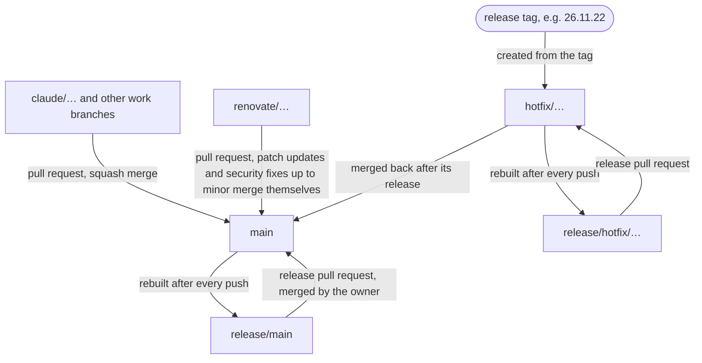
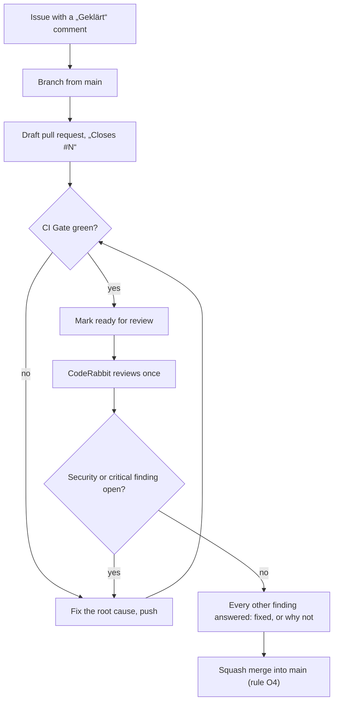
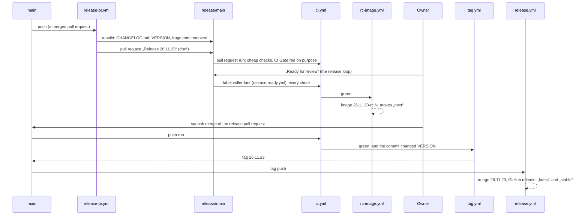
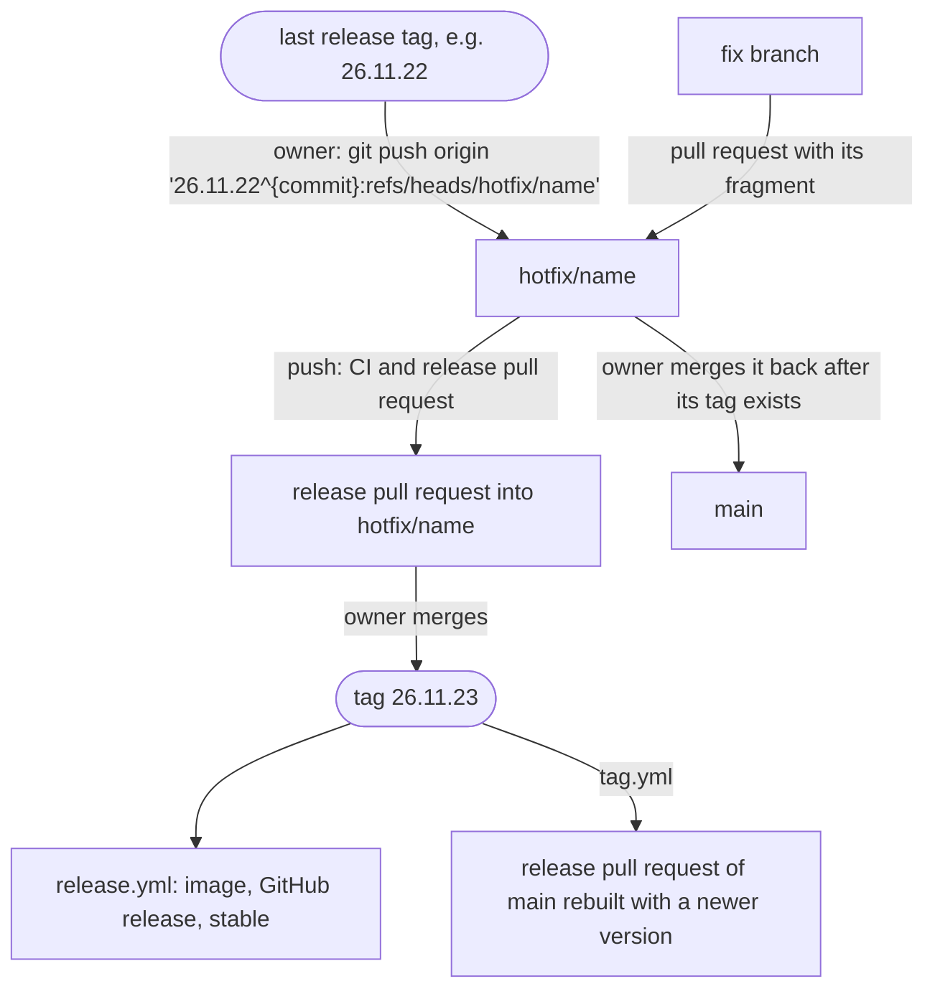

Nova Imperium uses GitHub Flow: `main` is always deliverable, work happens
on a short-lived branch and reaches `main` through a pull request with a
green CI Gate and a squash merge. A release is a decision of the owner, not
every merge: merging the release pull request „Release <version>“ is
the release button. The source of truth is
[Branching and release](/okf/ops/branching-release.md); the workflows are
in `.github/workflows/`, and [Automation](automation.md) shows how they
trigger each other.

## Branches

| Branch                  | Created by                                                                  | Purpose                                                                                                                                                     |
| ----------------------- | --------------------------------------------------------------------------- | ----------------------------------------------------------------------------------------------------------------------------------------------------------- |
| `main`                  | –                                                                           | Always deliverable. Changes only through pull requests; „CI Gate“ is its required check. Every push runs the full CI and rebuilds the release pull request. |
| `claude/…`              | the assistant                                                               | One branch per issue, one pull request each; up to two of its own pull requests are open at a time ([Release loop](/okf/ops/loop.md)).                      |
| `release/main`          | workflow „Release pull request“ (`release-pr.yml`, `scripts/release-pr.sh`) | Rebuilt from `main` and force-pushed after every push to `main`; head of the release pull request. Never edited by hand.                                    |
| `release/hotfix/<name>` | the same workflow, for a hotfix branch                                      | Head of the release pull request into `hotfix/<name>`.                                                                                                      |
| `hotfix/<name>`         | the owner, from the last release tag                                        | A fix of the last release without the unreleased work of `main`. Protected like `main` (ruleset „hotfix“).                                                  |
| `hotfix/sec-<id>`       | the release App, workflow „Security hotfix“                                 | An automatic security hotfix of the release `stable` names.                                                                                                 |
| `sec-fix/<id>`          | workflow „Security hotfix“                                                  | The pull request with the fixed versions into `hotfix/sec-<id>`; merges itself when the CI Gate is green.                                                   |
| `renovate/…`            | Renovate                                                                    | Dependency and image updates.                                                                                                                               |

## The pull request flow

1. **Draft.** The pull request starts as a draft. Every push to a pull
   request cancels its running CI and starts all jobs again, so pushes are
   bundled: no push of documentation alone while the CI runs
   ([Release loop](/okf/ops/loop.md)).
2. **CI.** Only a pull request with a green „CI Gate“ goes to review
   ([CI and checks](ci.md)).
3. **Ready.** Marking it ready starts the review. CodeRabbit reviews a pull
   request when it is opened or marked ready, not drafts and not later
   pushes (`.coderabbit.yaml`: `drafts: false`,
   `auto_incremental_review: false`); `@coderabbitai review` asks for
   another review. It comments and never requests changes.
4. **Merge under O4.** The assistant merges its own pull requests once the
   CI Gate is green and no finding is open: a finding about security or one
   marked „Critical“ is fixed before the merge, every other finding gets an
   answer in its thread (owner decision O4,
   [Branching and release](/okf/ops/branching-release.md)). The owner merges
   every release pull request; the assistant never does.
5. **Squash.** Every pull request lands as one commit whose subject ends
   with the pull request number, for example
   `Add the deploy mission „Verlegung“ to move ships to another own planet (#130)`.
   The release pull request lists the pull requests of a release from these
   subjects.

## Changelog fragments or `kein-changelog`

A pull request that players can notice adds a German fragment
`changes/<name>.md`; a pull request that changes `src/client`, `src/core`,
`src/features` or `src/server/game` without one fails the job „Changelog fragments“,
unless it carries the label `kein-changelog`. Adding or removing the label
re-runs the CI (`ci.yml` listens to `labeled` and `unlabeled`). The
fragments wait in `changes/` until the release pull request bundles them.
Details and an example: [Contributing](contributing.md#changelog-fragments-and-the-label-kein-changelog).

## The release pull request

After every push to `main` (and to `hotfix/**`), the workflow „Release pull
request“ runs `scripts/release-pr.sh` with the token of the release App –
a pull request opened with `GITHUB_TOKEN` would start no CI:

1. When nothing was merged since the last release tag, it closes an open
   release pull request and stops. When the push itself was the merge of a
   release pull request, it stops too: `tag.yml` takes over.
2. It rebuilds `release/main` from `main` as one commit „Release
   <version>“: the fragments become a German section of `CHANGELOG.md`
   (new before changed before fixed), `VERSION` holds the next version, the
   fragments are removed (`scripts/changelog.ts release`).
3. It opens or updates the pull request „Release <version>“ with the
   changelog section, the pull requests since the last tag and a checklist
   for the owner. The pull request is a draft from before the push until
   the version is confirmed free, so a failed run never leaves a duplicate
   version mergeable.
4. The release pull request of `main` stays a draft (#147): its CI runs
   only the cheap checks (secrets and dependencies, migrations, workflow
   lint, CodeQL, changelog fragments), and its CI Gate fails on purpose.
   A release pull request of a hotfix branch is marked ready at once.
5. It stays a draft while a released hotfix is not merged back into `main`:
   releasing `main` then would drop the fix from `stable`. Its body carries
   a marker, and „Release ready“ refuses „Ready for review“: it sets the
   pull request back to draft and comments why.

Marking the release pull request of `main` „Ready for review“ starts its
full run, with every check: the complete mutation run, the
Docker image with Trivy blocking High and Critical, the Compose stack, the
upgrade test and the smoke test ([CI and checks](ci.md)). The workflow
„Release ready“ (`release-ready.yml`) does that: it adds and removes the
label `voller-lauf` with the release App's token, and `ci.yml` runs on
those label events. The next rebuild sets the pull request back to draft.
The release loop marks it ready when the release is due; the owner checks
the texts and merges it; that is the release.

## Versions and tags

- **CalVer** `YY.M.MICRO` without a `v`, in Europe/Berlin: the first
  release of a month is `.0`, every further one counts up (`26.11.0`,
  `26.11.1`, …). The next version is the next one not taken by a tag, by
  `VERSION` or by another open release branch (`scripts/changelog.ts
next-version`).
- **Tag.** After the CI push run of the merge is green, `tag.yml` checks
  without any key whether the commit changed `VERSION`; only then does it
  use the environment `release`, and `scripts/release.sh` creates the
  annotated tag. Every other push is not tagged. The tag is pushed with the
  release App's token, so it starts `release.yml`.
- **Release.** `release.yml` checks again that CI passed for the tagged
  commit, builds the image for linux/amd64 and linux/arm64 and pushes
  `ghcr.io/heiss/nova-imperium:<version>`; the GitHub release has the
  German section of `CHANGELOG.md` as notes, followed by GitHub's list of
  pull requests. Its job „latest and stable“ points both aliases at the
  image of the newest release tag, whichever run gets there, so a re-run of
  an older release never moves them back.

## Release candidates

Every green CI run of a release pull request publishes a candidate image
for staging (`rc-image.yml`); for `main`, only its full run is green:

- `ghcr.io/heiss/nova-imperium:<version>-rc.<N>`, where N counts the merges
  on the base branch since the last release, so `rc.3` holds three merged
  pull requests;
- `next`, moved to it only while that run is still the head of the release
  branch.

In the candidate, `VERSION` holds `<version>-rc.<N>`: the game treats it as
a development build and sends no update message. `latest` and `stable`
only ever name releases. Candidate numbers are not Git tags. Do not run a
candidate on the production world: its migrations are not released yet
([Operations](/docs/operations.md#updates)).

## Hotfixes

When `main` holds no unreleased work, a hotfix is an ordinary pull request
and the next release pull request. Otherwise:

- Release tags are annotated, so the hotfix branch points at the commit of
  the tag (`<tag>^{commit}`).
- Pull requests into `hotfix/**` and pushes to it run every check, Trivy
  blocking High and Critical.
- After the hotfix release, `tag.yml` runs the workflow „Release pull
  request“ for `main`, so the next release of `main` takes a newer version
  and becomes `stable` again. The version of the merged-back hotfix is not
  tagged again.
- **Security hotfixes** run by themselves: an hourly Trivy scan of the
  newest release starts `hotfix/sec-<id>` with the fixed versions, and its
  pull requests merge themselves when the CI Gate is green; the owner merges
  it back into `main` ([Automation](automation.md#security-hotfix)).

## Renovate

Renovate opens pull requests from `renovate/…` branches for the
dependencies of `package.json` and `website/package.json`, the base image,
the GitHub Actions and the images the CI runs (`renovate.json`):

- `config:recommended` with `helpers:pinGitHubActionDigests`: every action
  is pinned to a commit hash with its version as a comment, and Renovate
  updates both.
- `minimumReleaseAge: 3 days`: an update waits three days after its
  release. Security pull requests from GitHub's Dependabot alerts wait for
  nothing; Dependabot's own security updates are off, so no hole gets two
  pull requests.
- Patch updates merge themselves once the CI Gate is green.
- Security pull requests merge themselves for patch, minor, pin and
  digest updates (`vulnerabilityAlerts` in `renovate.json`, also for
  development dependencies); below version 1.0 only a patch does. A major
  security update waits for the owner, and a red security pull request is
  fixed by the release loop in its own pull request or goes to the owner
  ([Branching and release](/okf/ops/branching-release.md)).
- Custom managers keep the digests of gitleaks, Trivy and actionlint and
  the version of zizmor in `ci.yml` up to date.

A Renovate pull request is a pull request like any other: it needs a green
CI Gate. An update of the game's dependencies changes `package.json` or
`pnpm-lock.yaml`, so it also builds the Docker image and runs Trivy; an
update of `website/` builds the website only ([CI and checks](ci.md)).
