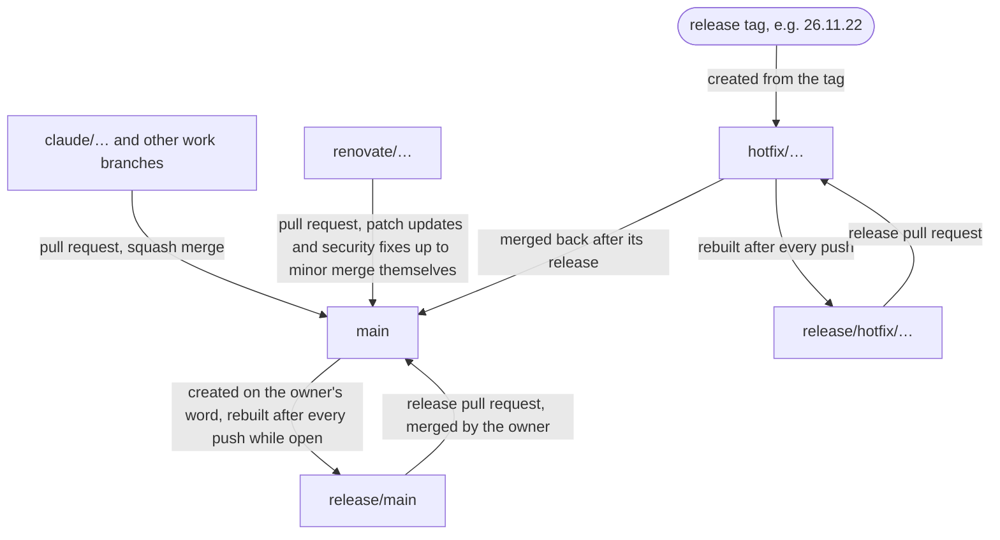
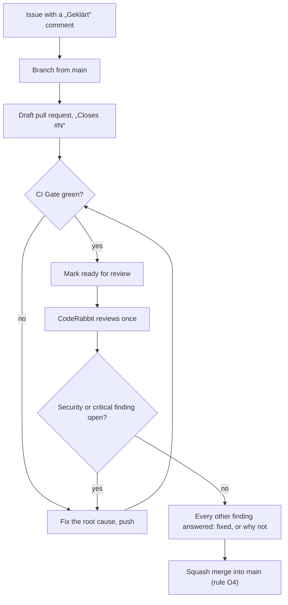
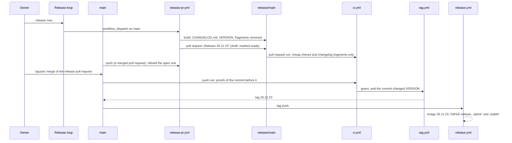
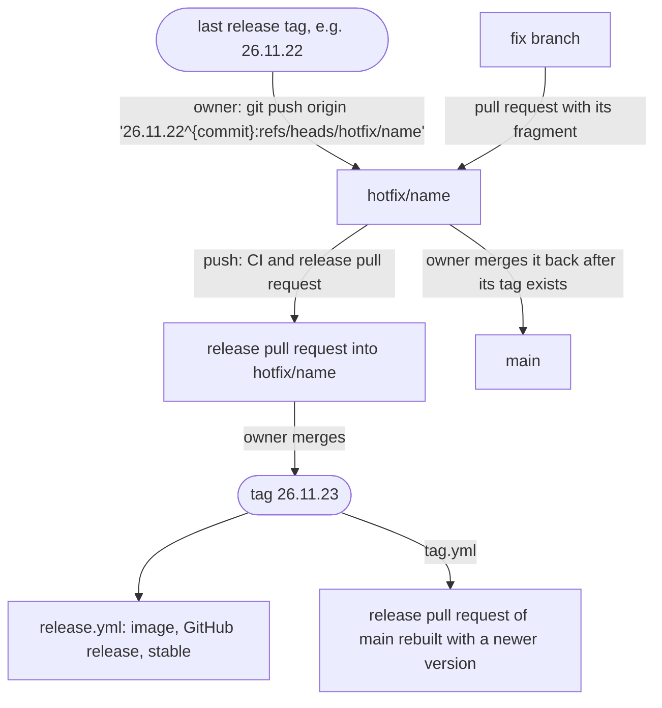

Nova Imperium uses GitHub Flow: `main` is always deliverable, work happens
on a short-lived branch and reaches `main` through a pull request with a
green CI Gate and a squash merge. A release is a decision of the owner, not
every merge: merging the release pull request „Release <version>“ is
the release button. The source of truth is
[Branching and release](/okf/ops/branching-release.md); the workflows are
in `.github/workflows/`, and [Automation](automation.md) shows how they
trigger each other.

## Branches

| Branch                  | Created by                                                                  | Purpose                                                                                                                                                                                                                      |
| ----------------------- | --------------------------------------------------------------------------- | ---------------------------------------------------------------------------------------------------------------------------------------------------------------------------------------------------------------------------- |
| `main`                  | –                                                                           | Always deliverable. Changes only through pull requests; „CI Gate“ is its required check. Every push runs the full CI and rebuilds an open release pull request.                                                              |
| `claude/…`              | the assistant                                                               | One branch per issue, one pull request each; up to four of its own pull requests are open at a time; it takes `main` in only before its merge ([Release loop](/okf/ops/loop.md)).                                            |
| `release/main`          | workflow „Release pull request“ (`release-pr.yml`, `scripts/release-pr.sh`) | Built from `main` when the workflow is started by hand on the owner's word, then rebuilt and force-pushed after every push to `main` while its pull request is open; head of the release pull request. Never edited by hand. |
| `release/hotfix/<name>` | the same workflow, for a hotfix branch                                      | Head of the release pull request into `hotfix/<name>`.                                                                                                                                                                       |
| `hotfix/<name>`         | the owner, from the last release tag                                        | A fix of the last release without the unreleased work of `main`. Protected like `main` (ruleset „hotfix“).                                                                                                                   |
| `hotfix/sec-<id>`       | the release App, workflow „Security hotfix“                                 | An automatic security hotfix of the release `stable` names.                                                                                                                                                                  |
| `sec-fix/<id>`          | workflow „Security hotfix“                                                  | The pull request with the fixed versions into `hotfix/sec-<id>`; merges itself when the CI Gate is green.                                                                                                                    |
| `renovate/…`            | Renovate                                                                    | Dependency and image updates.                                                                                                                                                                                                |

## The pull request flow

1. **Draft.** The pull request starts as a draft. Every push to a pull
   request cancels its running CI and starts all jobs again, so pushes are
   bundled: no push of documentation alone while the CI runs
   ([Release loop](/okf/ops/loop.md)).
2. **CI.** Only a pull request with a green „CI Gate“ goes to review
   ([CI and checks](ci.md)).
3. **Ready.** Marking it ready starts the review. CodeRabbit reviews a pull
   request when it is opened or marked ready, not drafts and not later
   pushes (`.coderabbit.yaml`: `drafts: false`,
   `auto_incremental_review: false`); `@coderabbitai review` asks for
   another review. It comments and never requests changes.
4. **Merge under O4.** The assistant merges its own pull requests once the
   CI Gate is green and no finding is open: a finding about security or one
   marked „Critical“ is fixed before the merge, every other finding gets an
   answer in its thread (owner decision O4,
   [Branching and release](/okf/ops/branching-release.md)). The owner merges
   every release pull request; the assistant never does.
5. **Squash.** Every pull request lands as one commit whose subject ends
   with the pull request number, for example
   `Add the deploy mission „Verlegung“ to move ships to another own planet (#130)`.
   The release pull request lists the pull requests of a release from these
   subjects.

## Changelog fragments or `kein-changelog`

A pull request that players can notice adds a German fragment
`changes/<name>.md`; a pull request that changes `src/client`, `src/core`,
`src/features`, `src/server/game` or `src/server/http` without one fails the job „Changelog fragments“,
unless it carries the label `kein-changelog`. Adding or removing the label
re-runs the CI (`ci.yml` listens to `labeled` and `unlabeled`). The
fragments wait in `changes/` until the release pull request bundles them.
Details and an example: [Contributing](contributing.md#changelog-fragments-and-the-label-kein-changelog).

## The release pull request

The release pull request of `main` is created only on the owner's word: the
release loop asks, and on yes starts the workflow „Release pull request“ on
`main` by hand (`workflow_dispatch`). It runs `scripts/release-pr.sh` with
the token of the release App – a pull request opened with `GITHUB_TOKEN`
would start no CI:

1. When nothing was merged since the last release tag, it closes an open
   release pull request and stops. When the push itself was the merge of a
   release pull request, it stops too: `tag.yml` takes over.
2. It rebuilds `release/main` from `main` as one commit „Release
   <version>“: the fragments become a German section of `CHANGELOG.md`
   (new before changed before fixed), `VERSION` holds the next version, the
   fragments are removed (`scripts/changelog.ts release`). It changes
   nothing else.
3. It opens or updates the pull request „Release <version>“ with the
   changelog section, the pull requests since the last tag and a checklist
   for the owner. The pull request is created as a draft and marked ready
   by the same run once its version is confirmed free, so a failed run never
   leaves a duplicate version mergeable.
4. It stays a draft while another release branch holds its version, or
   while a released hotfix is not merged back into `main`: releasing
   `main` then would drop the fix from `stable`. In that case its body
   carries the marker `<!-- release-pr: unmerged-hotfix -->` with a note.

A push to `main` rebuilds an open release pull request within minutes and
creates none. A push to `hotfix/**` builds the release pull request of that
hotfix branch at once.

The release pull request changes only `VERSION`, `CHANGELOG.md` and
`changes/`; „Detect changes“ refuses any other file. It runs no expensive
job – no unit tests, E2E, mutation, image or website – and relies on the
results of `main`: its CI Gate requires the cheap checks (secrets and
dependencies, migrations, workflow lint, CodeQL) and „Changelog
fragments“, and refuses an expensive job ([CI and checks](ci.md)). The
release loop checks its texts, waits for its green CI Gate and tells the
owner; the owner merges it; that is the release. There is no merge freeze
(#149): every merge into `main` while it waits rebuilds it, and the loop
checks it again and tells the owner again.

The push run of the release merge takes over the proofs of the commit
before it: it changes only the metadata files against its first parent, so
`scripts/already-tested.ts` gives it the proofs of that parent's green push
run. `tag.yml` then tags it, and `release.yml` publishes it.

Open points, marked [U] in
[Branching and release](/okf/ops/branching-release.md): what blocks a High
hole in a release of `main` now that its release pull request builds no
image, and what of this flow is verified only after the merge of #387.

## Versions and tags

- **CalVer** `YY.M.MICRO` without a `v`, in Europe/Berlin: the first
  release of a month is `.0`, every further one counts up (`26.11.0`,
  `26.11.1`, …). The next version is the next one not taken by a tag, by
  `VERSION` or by another open release branch (`scripts/changelog.ts
next-version`).
- **Tag.** After the CI push run of the merge is green, `tag.yml` checks
  without any key whether the commit changed `VERSION`; only then does it
  use the environment `release`, and `scripts/release.sh` creates the
  annotated tag. Every other push is not tagged. The tag is pushed with the
  release App's token, so it starts `release.yml`.
- **Release.** `release.yml` checks again that CI passed for the tagged
  commit, builds the image for linux/amd64 and linux/arm64 and pushes
  `ghcr.io/heiss/nova-imperium:<version>`; the GitHub release has the
  German section of `CHANGELOG.md` as notes, followed by GitHub's list of
  pull requests. Its job „latest and stable“ points both aliases at the
  image of the newest release tag, whichever run gets there, so a re-run of
  an older release never moves them back.

## The image `next`

After every green CI push run on `main`, `next-image.yml` builds the image
`ghcr.io/heiss/nova-imperium:next` for linux/amd64 and linux/arm64 and moves
`next` to it only while that run is still the head of `main`. Its `VERSION`
holds the short commit, and the image carries the OCI label
`org.opencontainers.image.revision`; the game shows no version for it.
`latest` and `stable` only ever name releases. `next` is for a test server
with `NOVA_VERSION=next`; do not run it on the production world: its
migrations are not released yet
([Operations](/docs/operations.md#updates)).

## Hotfixes

When `main` holds no unreleased work, a hotfix is an ordinary pull request
and the next release pull request. Otherwise:

- Release tags are annotated, so the hotfix branch points at the commit of
  the tag (`<tag>^{commit}`).
- Pull requests into `hotfix/**` and pushes to it run every check, Trivy
  blocking High and Critical. The release pull request of a hotfix branch
  follows the same rules as that of `main`: metadata only, no expensive
  job; the change of the hotfix comes in its fix pull request.
- After the hotfix release, `tag.yml` runs the workflow „Release pull
  request“ for `main`, so the next release of `main` takes a newer version
  and becomes `stable` again. The version of the merged-back hotfix is not
  tagged again.
- **Security hotfixes** run by themselves: an hourly Trivy scan of the
  newest release starts `hotfix/sec-<id>` with the fixed versions, and its
  pull requests merge themselves when the CI Gate is green; the owner merges
  it back into `main` ([Automation](automation.md#security-hotfix)).

## Renovate

Renovate opens pull requests from `renovate/…` branches for the
dependencies of `package.json` and `website/package.json`, the base image,
the GitHub Actions and the images the CI runs (`renovate.json`):

- `config:recommended` with `helpers:pinGitHubActionDigests`: every action
  is pinned to a commit hash with its version as a comment, and Renovate
  updates both.
- `minimumReleaseAge: 3 days`: an update waits three days after its
  release. Security pull requests from GitHub's Dependabot alerts wait for
  nothing; Dependabot's own security updates are off, so no hole gets two
  pull requests.
- Patch updates merge themselves once the CI Gate is green. Minor updates
  of a version from 1.0 on are merged by the release loop, one at a time.
- An ordinary major update and an ordinary minor update below 1.0 get no
  pull request until the owner ticks its box under „Pending Approval“ in
  the issue „Dependency Dashboard“. A security update needs no such
  approval: its pull request is opened at once, and a major one waits for
  the owner's merge.
- Renovate rebases a pull request only when it conflicts with `main`;
  only the updates that merge themselves follow `main`. To bring another
  one up to date before its merge, tick the box „rebase/retry“ at the end
  of its description.
- Security pull requests merge themselves for patch, minor, pin and
  digest updates (`vulnerabilityAlerts` in `renovate.json`, also for
  development dependencies); below version 1.0 only a patch does. A major
  security update waits for the owner, and a red security pull request is
  fixed by the release loop in its own pull request or goes to the owner
  ([Branching and release](/okf/ops/branching-release.md)).
- Custom managers keep the digests of gitleaks, Trivy and actionlint and
  the version of zizmor in `ci.yml` up to date.

A Renovate pull request is a pull request like any other: it needs a green
CI Gate. An update of the game's dependencies changes `package.json` or
`pnpm-lock.yaml`, so it also builds the Docker image and runs Trivy; an
update of `website/` builds the website only ([CI and checks](ci.md)).
